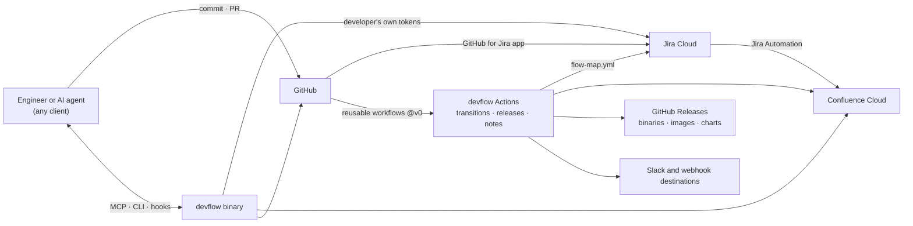

# devflow

[](https://github.com/nscaledev/devflow/actions/workflows/ci.yml)
[](https://github.com/nscaledev/devflow/actions/workflows/release.yml)

**devflow connects GitHub, Jira and Confluence into one delivery loop for Nscale
engineering.** Engineers state intent once, in the commit message, and devflow moves the
ticket, publishes the release, updates the docs and tells the team. The same rules apply
whether the work is done by a person in a terminal or by an AI agent in Claude Code,
Codex, Grok, Cursor, Copilot or Gemini.

| | |
| --- | --- |
| **Status** | The provider pilot and the isolated `nscaledev/mcp-gateway` canary and rollback passed. Consumer rollout awaits architecture approval (Kyle Redelinghuys, Vishal Srini). `nscaledev/mcp-gateway` remains in warn-only mode. |
| **Current release** | <!-- devflow:version -->`v0.38.0`<!-- /devflow:version --> · [CHANGELOG.md](CHANGELOG.md) · [all releases](https://github.com/nscaledev/devflow/releases) |
| **Owner** | Engineering Enablement · maintainer Ryan Helms |
| **Architecture** | [docs/blueprint.html](docs/blueprint.html): design, automations and rollout plan under review |
| **Support** | Open an issue in this repo · security issues: see [SECURITY.md](SECURITY.md) |

---

## Contents

- [Why devflow](#why-devflow)
- [What it does](#what-it-does)
- [Architecture](#architecture)
- [Getting started](#getting-started)
- [Day-to-day use](#day-to-day-use)
- [Commit convention](#commit-convention)
- [Versioning and releases](#versioning-and-releases)
- [AI client support](#ai-client-support)
- [Security and governance](#security-and-governance)
- [Operations](#operations)
- [How devflow itself is released](#how-devflow-itself-is-released)
- [Repository layout](#repository-layout)
- [Contributing](#contributing)
- [Documentation](#documentation)

## Why devflow

Without devflow, engineers move Jira tickets by hand, PRs link to tickets only when
someone remembers, releases are cut inconsistently, and Confluence drifts away from the
code. devflow makes git the source of truth and turns the rest into automation:

- **Tickets move themselves.** Branch, PR, merge and deploy events move each ticket
  through *its own team's* Jira workflow, using one reviewed status map.
- **Every deployable is versioned and released the same way.** Semantic versions come from
  commit types, every release is a GitHub Release with attested artifacts, and production
  only deploys releases.
- **Docs and notes write themselves.** Release notes, design-doc pages and sprint reports
  are generated into Confluence.
- **AI agents follow the rules.** The devflow plugin gives agents the ticket context, writes
  convention commits, previews Jira effects and asks before acting.

## What it does

| Area | Capabilities |
| --- | --- |
| **Commit and PR hygiene** | Commit convention with Jira keys, enforced locally (`commit-msg`) and in CI (`key-check` runs the same rules from `.devflow/config.yml` on the PR title and every commit, then checks the keys exist; `commit.require_key: false` makes keys optional) · generated, validated and split commits · PR readiness checks and PR creation from templates |
| **Ticket flow** | Branch → In Progress, PR → In Review, merge → QA/Done, deploy → Released, mapped per project in [`flow-map.yml`](flow-map.yml) · commit verbs `#start #review #qa #done #block` · forward-only transitions and provider previews |
| **Versioning and releases** | SemVer for apps, services, CLIs, images, Helm charts and libraries · one version per deployable unit · fully automatic GitHub Releases · branch-aware prerelease versions · production release guard with an approved hotfix path · Jira fix versions |
| **Confluence** | Release notes, docs-as-code sync, epic design pages, sprint reports from shared templates |
| **Signals** | Slack and webhook notifications with per-destination replay, hygiene checks (stale PRs, idle tickets), incident flow, Jira issues from security alerts and failing builds |
| **AI assist** | 29 MCP tools, ticket context at session start, acceptance-criteria tracking, scope-drift checks, standups, Claude PR drafts (opt-in) |

## Architecture



devflow has two halves that share one status map and one set of rules:

1. **Reusable GitHub Actions** (`.github/workflows/`, `actions/`) react to code events in
   every opted-in repo: task reference checks, ticket transitions, semantic releases, release
   guard, Confluence publishing, delivery notifications and hygiene. Repos call them from a single
   caller workflow, pinned to a release commit (`@<sha> # vX.Y.Z`) that `devflow pin`
   moves forward in a reviewed PR.
2. **The `devflow` binary**, one Go program that is a CLI, an MCP server and a set of git
   and AI-client hooks. Each repo commits a small launcher that installs the latest
   verified release on first use; the binary then keeps itself updated.

Responsibilities are split deliberately: the GitHub for Jira app links development data,
devflow Actions handle everything that starts in code, and Jira Automation handles
everything that starts in Jira. See [the blueprint](docs/blueprint.html#architecture).

## Getting started

### Enable devflow in a repository (repo owners)

Prerequisites: the org-level secrets and variables in
[docs/operations.md](docs/operations.md), and your project's block in
[`flow-map.yml`](flow-map.yml).

```bash
gh release download --repo nscaledev/devflow --pattern "devflow_*_$(uname -s | tr A-Z a-z)_$(uname -m | sed 's/x86_64/amd64/;s/aarch64/arm64/').tar.gz" -O - | tar -xz devflow
./devflow init && rm ./devflow
git add -A && git commit -m "chore(PLAT-123): enable devflow"
```

`devflow init` writes the files in [`templates/repo/`](templates/repo/) and sets up
releases:

| File | Purpose |
| --- | --- |
| `.devflow/config.yml` | Jira site and projects, commit rules, autonomy ceiling, update channel |
| `.devflow/releases.yml` + release-please files | Deployable units and branching strategy for semantic releases |
| `.devflow/bin/devflow` (+ `.cmd`, `.ps1`) | Launcher: installs and verifies the binary, then runs it |
| `.githooks/commit-msg` | Local commit convention check |
| `.github/workflows/devflow.yml` | The one caller workflow for every devflow Action, pinned to the release commit (`@<sha> # vX.Y.Z`) |
| `.jira/config.yml` | Maps GitHub Environments to Jira deployment environments |
| `.claude/`, `.codex/`, `.grok/`, `.cursor/`, `.vscode/`, `.gemini/`, `AGENTS.md` | AI client configuration |

Disable devflow in a repo at any time with the repository variable `DEVFLOW_ENABLED=false`:
every job in the caller workflow checks it.

**Automatic setup with the Claude Code plugin.** When a Claude Code session starts in a
repo with no `.devflow/config.yml` and the repo's GitHub owner is in your `init.orgs`
(default `nscaledev`), the plugin runs `devflow init` for you. It writes the files above
and commits nothing; Claude tells you what was written and offers a branch and PR. Choose
the behaviour in `~/.devflow/config.yml`:

```yaml
init:
  auto: auto        # auto (default) | ask (only suggest /devflow:init) | off
  orgs: [nscaledev]
```

**Updating the pinned workflows.** `devflow pin` (or `/devflow:pin`) moves every
`nscaledev/devflow` reference in `.github/workflows/devflow.yml` to the release you have
installed; commit it in a PR. `devflow pin --check` and `devflow doctor` report a pin
that is behind, and the Claude Code session hook offers `/devflow:pin` when it is. No
Dependabot or GitHub App access is needed.

**Removing devflow.** `devflow remove` (or `/devflow:remove`) undoes `init`: it deletes
the generated configuration and launchers under `.devflow/`, the caller workflow,
the release-please files (`--keep-releases` keeps them), and unchanged template files
(`--force` deletes changed ones too). It removes devflow's entries from `AGENTS.md` and
client configs, unsets `core.hooksPath`, and turns
automatic setup off for that clone. `--dry-run` lists the changes first. Commit the result
in a PR. Authored task and knowledge records under `.devflow/` are preserved.

For provider MCP companions, removal compares each project entry with the receipt
written by setup. It removes unchanged, recorded entries and lists edited or
untracked entries for manual review, including registrations from older versions.
The shared installation stays available to other projects. [Companion cleanup and repair](docs/providers.md#companion-cleanup-and-repair).

### Set up your machine (engineers)

Opening the repo in a supported client runs the devflow launcher.

```bash
devflow setup plan --client NAME   # preferred provider MCP and CLI fallback
devflow doctor --fix               # checks binary, hooks, flow map and client config
```

The [provider configuration reference](docs/providers.md) documents independent
service sections, versioned settings, defaults, and their override rules. Jira tasks
and Confluence can use separate sites and credentials. See the
[migration and rollback rehearsal](docs/rollout.md#provider-migration-rehearsal)
and the [provider authoring guide](docs/provider-authoring.md). Use the
`filesystem` knowledge provider to search a local directory with
`devflow docs search` or `devflow_docs_search`.

Run `devflow setup providers` (MCP: `devflow_setup_providers`) to list every provider
each role accepts, its default, which one this repo selects, and how to verify
readiness. Jira, Confluence, Slack, and Asana support client verification. Headless
setup can also probe Asana directly with an explicit `ASANA_ACCESS_TOKEN`.
Add `--explain` to see the selected providers' effective settings and which layer
set them. Personal defaults can narrow the repository’s configured write targets.
Both native and fallback writes enforce the repository scope. Restart the MCP
server to pick up configuration edits. [Provider definitions](docs/providers.md#provider-definitions).
Run `devflow setup plan --client NAME` to see which providers and companions
are ready in the current environment. `devflow setup apply --client NAME`
registers a supported project adapter after approval. `devflow setup verify`
checks provider readiness and returns an error for missing requirements.
In an agent session, use the setup skill to reuse the provider's connected MCP
or start its OAuth flow. Use `devflow setup login --provider NAME` to start
the supported vendor CLI's browser login when no MCP is available. In a Claude Code
Desktop workspace, `devflow setup login --provider slack --client claude-desktop --register`
can register the official Slack connector locally and start Claude’s sign-in flow.
The same command with `--provider asana` reuses the official Asana V2 connector.
For a new Asana connector, pass `--client-id ID` from an approved MCP app and
enter the app secret at Claude’s secure prompt.
[Interactive provider setup](docs/providers.md#interactive-provider-setup).

For Devflow’s own Slack connection, start browser consent with
`devflow setup login --provider slack --client devflow --public-client-id CLIENT_ID --team-id TEAM_ID`.
Use the approved PKCE-enabled app’s public client ID and the destination’s Slack workspace ID.
The user approves in Slack. Devflow checks the workspace before storing the grant in the OS keychain.
[Slack app and callback setup](docs/providers.md#devflow-slack-enrollment).

Jira work and issue context, Confluence search, and individual Asana and
GitHub issue reads can use the client’s connected provider MCP. Atlassian
reads can fall back to Teamwork Graph CLI, and interactive GitHub API calls
use the signed-in GitHub CLI. A connected Codex MCP can also handle Jira issue
writes and web links, Confluence page replacement, selected Asana and GitHub
Issues writes, and Slack delivery. Devflow binds approval to the authenticated
session and exact operation. Use `devflow --native-client codex` for supported
CLI writes, `devflow_jira_remote_link` for Jira web links, and `devflow_notify`
for delivery. When using its own Slack enrollment, Devflow checks the workspace
and configured actor against the stored grant before connecting to Slack MCP.
A Slack send with an uncertain outcome keeps its receipt claim and
blocks another send for the same operation and destination.

The Claude Code Desktop pilot uses separate Devflow Rovo enrollments for Jira
and Confluence. Alongside Jira web links, a fixture-tested `devflow_comment`
route adds one comment after approval and returns its verified comment ID.
The CLI equivalent is `devflow --native-client claude-desktop comment [KEY] TEXT`.
If the MCP comment capability is unavailable, interactive clients can use the
Teamwork Graph CLI’s saved OAuth login. Run `devflow setup login --provider jira`
to sign in. The preview shows the profile, site, project, issue and comment.
Each approval permits one post. If the outcome is uncertain, inspect the issue
before approving again. Unattended Jira REST workflows keep their configured identity.

With the same Jira enrollment, `devflow_transition` previews a forward move
and `devflow_start` creates the branch or worktree, assigns the issue to the
signed-in Jira user and applies the configured start transition. Both require
approval. Devflow reads the issue on the write connection to verify each change.
Hosted Jira canaries verified forward transitions and self-assignment.

For Confluence, use `devflow setup login --provider confluence --client devflow`
and preview the update with `devflow_docs_publish`. Desktop verifies the page’s
space ID and key on the same site before it can publish. Repositories can limit
publication to space keys in `knowledge_base.settings.publish_spaces`.

In a regular Claude Code Desktop session, `devflow_ticket_create` can create an
unlinked Jira issue through the Devflow Rovo enrollment. Devflow checks the Jira
project and issue type, then requests approval for the exact issue. When the MCP
create operation is unavailable, an interactive `devflow_ticket_create` or
`devflow task create` can use the signed-in Teamwork Graph CLI. The preview
binds the OAuth profile, site, project, issue type, title, description and
labels. Devflow returns the key after verifying the new issue on that profile.
This fallback has been tested with fixtures.

The same tool can create a GitHub issue through signed-in `gh`. Its interactive
preview shows the GitHub account and repository. If sign-in is needed, run
`devflow setup login --provider github-issues` from the checkout.
[Provider setup](docs/providers.md#interactive-provider-setup) ·
[Slack destination configuration](docs/notifications.md)

If Claude Code Desktop on macOS is missing the devflow tools, run
`devflow setup apply --client claude-desktop` in the enrolled checkout.
It registers the project launcher in `.mcp.json`. Restart Claude Code Desktop,
approve the project server if prompted, and look for `mcp__devflow__devflow_setup_plan`.
Use `--client claude` for the Claude Code plugin marketplace.
[Desktop setup and verification](docs/providers.md#claude-code-desktop).

On macOS and Linux, if a selected GitHub provider needs `gh` and the PATH
copy fails its version check or is missing, you can pin a raw executable in
`~/.devflow/companions.yml` and approve `devflow setup apply --install-gh`.
Devflow verifies its SHA256 and uses the cached executable directly. See the
[manifest format and MCP confirmation flow](docs/providers.md#install-a-pinned-gh-companion).

To add a provider MCP server, declare its native executable pins or HTTPS
endpoint in your user-owned `~/.devflow/mcp-companions.yml`. Run
`devflow setup verify --companion ID` to check the MCP handshake and tool
discovery headlessly. Approve installation and registration separately in
VS Code, Cursor, Claude Code or Gemini CLI. [Provider MCP setup](docs/providers.md#register-a-provider-mcp-companion).

FileSystem and Repository knowledge can read nested OKF v0.3 concepts alongside
legacy Devflow documents. See [OKF knowledge bundles](docs/providers.md#read-an-okf-knowledge-bundle).

Choose the `repository` knowledge provider to search a Git destination and
publish managed Markdown with `devflow docs publish`. A GitHub review
publication returns the PR link and a pending review status.

Select `knowledge_base.provider: github-wiki` to search and publish managed
pages with the same CLI and MCP tools. Enable Wikis, create the first page on
GitHub, and configure Git credentials for the wiki remote. Publication uses the
remote approval policy and targets the wiki's default branch. See the
[GitHub Wiki configuration and commands](docs/providers.md#publish-a-github-wiki-page).

Create tasks with `devflow task create --summary "Review capacity"` or
`devflow_ticket_create`. Both use the configured task provider. Use
`--dry-run` to inspect the resolved task and `--yes` to approve in a
noninteractive workflow. To select a catalog revision, pass
`--template NAME --template-revision REV` or the MCP fields `template`
and `template_revision`. Omit both to use the configured default.

Select `asana` to list open project tasks, start a branch from a plain task GID,
read linked knowledge documents and move a task to a configured section.
Set the default project GID and provide `ASANA_ACCESS_TOKEN` in the calling
environment. Verify access with `devflow setup verify`.
[Asana setup, project mappings and capabilities](docs/providers.md#asana-project-tasks)

Select `github-issues` in `task_management.provider` to work with GitHub issues
through the existing task commands. Start an issue with `devflow start '#42'`
when the issue repository is known, or specify `owner/repo#42`. Devflow carries
the qualified issue reference in the PR body and interactive commit message.
Configure a catalog and default under `task_management.templates` to preview new issues
with template defaults, required sections and checklist items. Devflow records
the selected revision and validates the issue against it before a comment or
state change. See the [task template configuration](docs/providers.md#task-templates).

New issues created through devflow in this repository use the
[`engineering-task` template](.devflow/task-templates.json).
The [OKF rollout plan](docs/okf-rollout.md) tracks the compatible reader,
knowledge migration, and full repository workflow.
The pinned `jira-key.yml` and `transitions.yml` workflows use the configured
task provider. Validation checks the squash title and each commit. The
existing Jira paths apply transitions and fix versions when configured.
Other task providers use previews in the generic transition, ship and release
workflows. Apply a reviewed change through `devflow transition`. For GitHub Issues and Asana, PR and commit bodies carry
qualified `Task-Ref` trailers. The optional `task-events.yml` PR preview uses
read-only issue permissions. The [consumer canary](docs/consumer-canary.md)
covers runner credentials, event replay, release outputs and pin rollback.

Use `devflow secops triage` to preview tasks from configured GitHub findings
and fixture incidents. Apply a source reference to create a linked task using
the selected task provider's template and approval policy. The reusable
`secops-triage.yml` workflow calls the same command.
[SecOps configuration and replay](docs/secops.md)

Select `filesystem` or `repository` to manage Markdown tasks. Start work with
`devflow start <qualified-key>` to bind a local branch or worktree to the task.
With a default task template, both providers store its exact name and revision
in the Markdown front matter and validate the task against it before closing.
FileSystem writes use local autonomy. Repository creates and transitions require
remote confirmation. By default they return `pending_review` with the task key,
GitHub PR URL and review branch. The task listing reflects the change after
merge. Use `publication: push` for direct writes to an unprotected branch.
[Provider configuration](docs/providers.md)

Confluence search returns the page ID, space key and revision in `devflow docs search QUERY --json`.
Use `devflow docs publish confluence/SPACE/PAGE_ID` with the expected revision
to replace an existing page through the remote approval policy. The page body
displays Markdown as literal text. See the [Confluence example](docs/providers.md#replace-a-confluence-page).

`devflow status` reads checks and deployments from their own `devops` providers.
Deployments match the open PR's head commit or the local `HEAD` when there is no
open PR. Use `devflow release get TAG` to inspect a release from `devops.releases`.
GitHub lookup includes the tagged commit and any assets attached by the build pipeline.
Deployments and release lookup also support local JSON fixtures.
[DevOps provider configuration](docs/providers.md#deployment-and-release-providers)

## Day-to-day use

| Task | Terminal | AI client |
| --- | --- | --- |
| Create a task | `devflow task create` | `devflow_ticket_create` |
| Pick up a ticket | `devflow start` | `/devflow:start` or "start PLAT-123" |
| See the ticket context | `devflow context` | loaded automatically at session start |
| Track acceptance criteria | `devflow ac`, `devflow ac done ITEM --evidence SHA` | `/devflow:ac` |
| Check for scope drift | `devflow scope` | `/devflow:scope` |
| Comment on the task | `devflow comment [KEY] TEXT` | `/devflow:comment` |
| Check for overlapping PRs | `devflow collisions` | `/devflow:collisions` |
| Commit | `devflow commit` (or plain `git commit`) | `/devflow:commit` |
| Preview Jira effects | `devflow preview` | shown before every commit |
| Check PR readiness | `devflow pr --check` | `devflow_pr_ready` |
| Open a PR | `devflow pr` | `/devflow:pr` |
| Address review comments | `devflow review`, `devflow review reply THREAD_ID BODY` | `/devflow:review` |
| Check CI, deploys, ticket | `devflow status` | `/devflow:status` |
| Standup | `devflow standup` | `/devflow:standup` |
| End-of-day task comments | `devflow eod post KEY=NOTE` | `/devflow:eod` |
| Next release version | `devflow release plan` | "what version will this ship as?" |

PR readiness requires a Jira key in the branch name by default. With
`commit.require_key: false` in `.devflow/config.yml`, a keyless branch can pass
readiness if its other checks pass. To open a PR from that branch, supply a
conventional title with `devflow pr --title "feat: add quota"` or the
`devflow_pr_open` tool's `title` input.

Each developer chooses an autonomy level per action class (`suggest`, `confirm` or
`auto`) in `~/.devflow/config.yml`, capped by the repo's `policy.max_autonomy`. The
default is `confirm`: the agent shows what it will do and waits.

The table above gives the terminal commands for the same day-to-day operations.
When a provider write needs confirmation, the CLI shows the approval summary. Pass
`--yes` to accept it. For supported writes through a connected Codex provider, put
`--native-client codex` before the command. See [provider routing and examples](docs/providers.md).

## Commit convention

```
<type>(<JIRA-KEY>[,<KEY>])[!]: <imperative summary> [#verb]

[body: why the change was needed]

[BREAKING CHANGE: what breaks and how to migrate]
[Refs: PLAT-456]
[Devflow: skip]
```

- `type`: `feat fix perf refactor docs test build ci chore revert`
- `#start #review #qa #done #block` select ticket transitions from `flow-map.yml`. Jira Smart
  Commits still handle `#comment` and `#time`
- `feat` → minor, `fix`/`perf` → patch, `!` or `BREAKING CHANGE:` → major
- No AI attribution trailers; devflow strips known ones
- PR titles follow the same format and are checked as the squash commit they become
  (`<title> (#123)` ≤ 72 characters), before the PR is created and again in CI

## Versioning and releases

Every deployable asset is versioned with SemVer and shipped as a GitHub Release, which is
the system of record for what runs in production.

- **Automatic.** Each merge to the default branch with `feat`, `fix` or `!` commits
  publishes a release for every changed unit, with changelog, artifacts and attestations.
- **Per deployable.** Units live in `.devflow/releases.yml`; monorepo tags carry the unit
  (`api-v1.4.0`).
- **Branch-aware.** Other branches build prereleases: `-alpha` (GitFlow `develop`),
  `-rc` (`release/*`), `-hotfix` (`hotfix/*`), `-pr` (everything else).
- **Production takes releases.** `actions/release-guard` blocks anything but a published
  release, except an approved hotfix through the `production-hotfix` environment, which
  must end in a patch release.
- **Artifacts.** Binaries (GoReleaser), container images (`X.Y.Z`, `X.Y`, `X`, sha),
  Helm charts (OCI) and libraries (Go submodule tags, npm, PyPI, Terraform).

Full rules and examples: [docs/releases.md](docs/releases.md).

For a manual release, `devflow release publish TAG --revision SHA --dry-run`
previews the destination and commit. Publication takes an explicit full commit
SHA and confirmation under the remote autonomy policy. Retry the same tag, SHA,
title and notes to reconcile the result.
[Manual release publication](docs/releases.md#publish-an-explicit-release)

## AI client support

| Layer | Claude Code | Codex CLI | Grok CLI | Cursor · Copilot · Gemini | Terminal |
| --- | --- | --- | --- | --- | --- |
| Tools | Plugin MCP | MCP | MCP | MCP | CLI |
| Instructions | Plugin skill | `AGENTS.md` | Instructions file | `AGENTS.md` / rules | – |
| Commands | `/devflow:*` skills | Custom prompts | Where supported | Where supported | Subcommands |
| Hooks | SessionStart, PreToolUse, Stop | git hooks | git hooks | git hooks | git hooks |

Enforcement is identical everywhere: the `commit-msg` hook locally and the PR `key-check` (same rules, same `.devflow/config.yml`) in
CI.

The Claude Code plugin has a skill for every CLI command: `/devflow:init`, `remove`,
`install`, `setup`, `login`, `logout`, `doctor`, `work`, `start`, `context`, `ac`, `scope`,
`comment`, `collisions`, `commit`, `preview`, `transition`, `pr`, `review`, `status`, `standup`,
`eod`, `docs`, `adr`, `release`, `update` and `version`. The plugin's `bin/devflow` is on Claude's PATH and installs the latest verified
release on first use, so the skills work in repos devflow has not set up yet. Skills that
change the repo or your credentials (`init`, `remove`, `install`, `login`, `logout`,
`update`) run only when you invoke them. Install the Claude Code plugin for yourself with
`/plugin install devflow --marketplace nscaledev/devflow`; repos enable it for everyone
through `.claude/settings.json`.

## Security and governance

- **Identity.** Writes use each developer's own Atlassian and GitHub credentials. GitHub
  Wiki uses Git's configured credentials. CI uses a scoped service account.
- **Release integrity.** devflow installs only builds whose SHA-256 and GitHub build
  attestation both verify, and the attestation must come from devflow's release workflow
  (`gh attestation verify --repo nscaledev/devflow --signer-workflow nscaledev/devflow/.github/workflows/release.yml`).
  The caller workflow gives each job only the secrets and permissions it uses.
- **Untrusted content.** Ticket, page and review text reaches agents as labelled reference
  data; remote writes derived from it always need confirmation.
- **Never list.** At every autonomy level devflow refuses force-pushes, pushes to protected
  branches, PR merges, remote branch deletes and acting as another user.
- **Audit.** Every local and remote action is logged to `~/.devflow/audit.log`.
- **Change control.** `flow-map.yml` blocks need the owning team lead's approval
  ([CODEOWNERS](CODEOWNERS)); caller workflows pin devflow to a release
  commit SHA, and each new devflow release reaches a repo only through a reviewed
  `devflow pin` PR. The reusable workflows load devflow's `setup` action at `@v0`, which only
  devflow's release workflow and repo admins can move: the "Protect release tags"
  ruleset guards every `v*` tag ([docs/operations.md](docs/operations.md#releases)).

Report vulnerabilities as described in [SECURITY.md](SECURITY.md).

## Operations

| Task | How |
| --- | --- |
| Org secrets, optional GitHub App, Atlassian service account | [docs/operations.md](docs/operations.md) |
| Configure and replay delivery notifications from CI or `devflow notify` | [docs/notifications.md](docs/notifications.md) |
| Rollout phases and checklists | [docs/rollout.md](docs/rollout.md) |
| Stop a bad devflow release everywhere | Add it to `blocked` in [`policy/versions.json`](policy/versions.json); installs update or stop on their next start |
| Pause devflow in one repo | Repository variable `DEVFLOW_ENABLED=false` |
| Roll back the binary on a machine | `devflow update --rollback` |

## How devflow itself is released

This section is about the devflow repository's own releases, not the release tooling
devflow offers other repos.

- **Single branch.** Every push to `main` derives the next version from the commit types
  since the last `vX.Y.Z` tag (`bin/next-version.sh`). The release workflow generates the
  [CHANGELOG.md](CHANGELOG.md) section from those commits, commits it as
  `chore(release): vX.Y.Z`, tags it and publishes the GitHub Release with the same notes.
  No Release PR.
- **Same commit convention as devflow-managed repos.** Enforced locally by
  `.githooks/commit-msg` and in CI on every PR title and commit. `CHANGELOG.md` is never
  edited by hand.
- **Stable immediately.** Every release is a normal GitHub Release marked "Latest", and the
  floating major tag (`v0` while devflow is 0.x) moves to it. Safety comes from
  `policy/versions.json` (block a version everywhere) and `devflow update --rollback`.
- **Updates.** Installs check at most every 6 hours without blocking, verify each build,
  swap it in atomically, and keep the previous version for rollback.
- **Merging.** PRs are squash-merged, so the PR title decides the version bump.

## Repository layout

```
cmd/devflow/              CLI entry point
internal/                 operations (app), MCP server, hooks, commit engine, flow map,
                          release maths, policy, self-update, Atlassian and GitHub clients
adapters/                 per-client files; adapters/claude-code is the Claude Code plugin
templates/repo/           files devflow init writes into a consuming repo
.github/workflows/        devflow's CI and releases, plus reusable workflows for other repos
actions/                  composite actions: setup, ship, version, release-guard
bin/                      shell helpers used by workflows and actions
flow-map.yml              canonical events → each project's Jira statuses
policy/versions.json      minimum and blocked devflow versions
jira-automation/          Jira Automation rule specs
confluence-templates/     design doc, postmortem, release notes, sprint report
docs/                     blueprint, releases, rollout, operations
scripts/                  e2e test, blueprint build, agent-docs check
```

## Contributing

```bash
make check     # vet, race tests, golangci-lint, shellcheck, actionlint, agent docs
make e2e       # end-to-end Claude Code plugin test
```

Read [CONTRIBUTING.md](CONTRIBUTING.md) first. AI agents working on this repo follow
[AGENTS.md](AGENTS.md); `CLAUDE.md` only points to it and must not be edited.

## Documentation

| Document | For |
| --- | --- |
| [docs/blueprint.html](docs/blueprint.html) | Architecture, automations, plugin, rollout and decisions |
| [docs/releases.md](docs/releases.md) | Semantic versioning, GitHub Releases, release guard |
| [docs/rollout.md](docs/rollout.md) | Phase-by-phase rollout checklist |
| [docs/operations.md](docs/operations.md) | Secrets, apps, accounts, token rotation, blocking releases |
| [CHANGELOG.md](CHANGELOG.md) | Generated release history of devflow |
| [CONTRIBUTING.md](CONTRIBUTING.md) | Building, testing and changing devflow |
| [AGENTS.md](AGENTS.md) | Instructions for AI agents working on this repo |
| [SECURITY.md](SECURITY.md) | Security model and reporting |

---

Internal to Nscale. Not licensed for external use or distribution.
