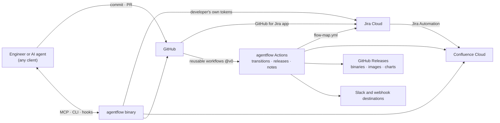

# agentflow

[](https://github.com/ryanhelms/agentflow/actions/workflows/ci.yml)
[](https://github.com/ryanhelms/agentflow/actions/workflows/release.yml)

**agentflow connects GitHub, Jira and Confluence into one delivery loop.** Engineers state
intent once, in the commit message, and agentflow moves the ticket, publishes the release,
updates the docs and tells the team. The same rules apply whether the work is done by a person
in a terminal or by an AI agent in Claude Code, Codex, Grok, Cursor, Copilot or Gemini.

| | |
| --- | --- |
| **Status** | Public and MIT-licensed. The repository moved to `ryanhelms/agentflow` on 2026-11-25, and issue and PR numbers restarted at #1; repositories that still pin the previous location move with `agentflow pin`. The plugin marketplace is now `agentflow`: [reinstall plugins installed before the rename](#reinstall-plugins-after-the-marketplace-rename). agentflow uses a Git-backed OKF knowledge bundle. The ACP platform program is running: its PRs merge into the `develop` integration branch ([docs/plans/acp-platform/](docs/plans/acp-platform/)). |
| **Owner** | Ryan Helms |
| **Architecture** | [docs/blueprint.html](docs/blueprint.html): architecture and rollout plan |
| **Support** | Open an issue in this repo · security issues: see [SECURITY.md](SECURITY.md) |
| **Current release** | <!-- agentflow:version -->`v0.62.0`<!-- /agentflow:version --> · [CHANGELOG.md](CHANGELOG.md) · [all releases](https://github.com/ryanhelms/agentflow/releases) |

---

## Contents

- [Why agentflow](#why-agentflow)
- [What it does](#what-it-does)
- [Architecture](#architecture)
- [Getting started](#getting-started)
- [Day-to-day use](#day-to-day-use)
- [Commit convention](#commit-convention)
- [Versioning and releases](#versioning-and-releases)
- [AI client support](#ai-client-support)
- [Security and governance](#security-and-governance)
- [Operations](#operations)
- [How agentflow itself is released](#how-agentflow-itself-is-released)
- [Repository layout](#repository-layout)
- [Contributing](#contributing)
- [Documentation](#documentation)
- [License](#license)

## Why agentflow

Without agentflow, engineers move Jira tickets by hand, PRs link to tickets only when
someone remembers, releases are cut inconsistently, and Confluence drifts away from the
code. agentflow makes git the source of truth and turns the rest into automation:

- **Tickets move themselves.** Branch, PR, merge and deploy events move each ticket
  through *its own team's* Jira workflow, using one reviewed status map.
- **Every deployable is versioned and released the same way.** Semantic versions come from
  commit types, every release is a GitHub Release with attested artifacts, and production
  only deploys releases.
- **Docs and notes write themselves.** Release notes, design-doc pages and sprint reports
  are generated into Confluence.
- **AI agents follow the rules.** The agentflow plugin gives agents the ticket context, writes
  convention commits, previews Jira effects and asks before acting.

## What it does

| Area | Capabilities |
| --- | --- |
| **Commit and PR hygiene** | Commit convention with Jira keys, enforced locally (`commit-msg`) and in CI (`key-check` runs the same rules from `.agentflow/config.yml` on the PR title and every commit, then checks the keys exist; `commit.require_key: false` makes keys optional) · generated, validated and split commits · PR readiness checks and PR creation from templates |
| **Ticket flow** | Branch → In Progress, PR → In Review, merge → QA/Done, deploy → Released, mapped per project in [`flow-map.yml`](flow-map.yml) · commit verbs `#start #review #qa #done #block` · forward-only transitions and provider previews |
| **Versioning and releases** | SemVer for apps, services, CLIs, images, Helm charts and libraries · one version per deployable unit · fully automatic GitHub Releases · branch-aware prerelease versions · production release guard with an approved hotfix path · Jira fix versions |
| **Confluence** | Release notes, docs-as-code sync, epic design pages, sprint reports from shared templates |
| **Signals** | Slack and webhook notifications with per-destination replay, hygiene checks (stale PRs, idle tickets), incident flow, Jira issues from security alerts and failing builds |
| **Plugins** | Add behaviour without changing agentflow: YAML rules or a small program, installed from a local path after a confirmation that lists every permission, turned on in your personal settings, with its own settings on the Settings page · see [docs/plugins.md](docs/plugins.md) |
| **AI assist** | 57 MCP tools, detection of the AI coding agents (ACP harnesses) on your machine, a live event stream of git and configuration changes, ticket context at session start, acceptance-criteria tracking, scope-drift checks, standups, Claude PR drafts (opt-in) |

## Architecture



agentflow has two halves that share one status map and one set of rules:

1. **Reusable GitHub Actions** (`.github/workflows/`, `actions/`) react to code events in
   every opted-in repo: task reference checks, ticket transitions, semantic releases, release
   guard, Confluence publishing, delivery notifications and hygiene. Repos call them from a single
   caller workflow, pinned to a release commit (`@<sha> # vX.Y.Z`) that `agentflow pin`
   moves forward in a reviewed PR.
2. **The `agentflow` binary**, one Go program that is a CLI, an MCP server and a set of git
   and AI-client hooks. Each repo commits a small launcher that installs the latest
   verified release on first use; the binary then keeps itself updated.

Responsibilities are split deliberately: the GitHub for Jira app links development data,
agentflow Actions handle everything that starts in code, and Jira Automation handles
everything that starts in Jira. See [the blueprint](docs/blueprint.html#architecture).

## Getting started

### Enable agentflow in a repository (repo owners)

Sign in to the GitHub CLI with access to `ryanhelms/agentflow`. Run the command for
your OS from the project or one of its subdirectories. If you start outside a
Git worktree, the installer keeps asking for a checkout path until you supply
one or cancel.

**macOS or Linux**

```bash
s=$(gh release download -R ryanhelms/agentflow -p install.sh -O -) && bash -c "$s" agentflow
```

Append `--repo '/path/to/my project'` to target a checkout.

**Windows PowerShell**

```powershell
$s = gh release download -R ryanhelms/agentflow -p install.ps1 -O -; if ($LASTEXITCODE -eq 0) { & ([scriptblock]::Create($s -join "`n")) }
```

Add `-Repo 'C:\src\my project'` before the closing brace to supply the path.
Both commands install the verified stable binary and run `agentflow init`.
The interactive setup shows provider evidence, lets you change a selection and
asks about roles it cannot determine. Choices are saved with the project.
Agents can read the same suggestions with `agentflow init --detect-providers`
and apply choices with `--non-interactive --provider ROLE=ID`.
Review and commit the generated project files. For integrations, configure the
organization-level settings and the project's flow map.
[Upgrade from Devflow](docs/agentflow-migration.md) · [Agent installation guide](docs/knowledge/engineering/guides/project-installation.md) · [Operations](docs/operations.md) · [Flow map](flow-map.yml)

`agentflow init` writes the files in [`templates/repo/`](templates/repo/) and sets up
releases:

| File | Purpose |
| --- | --- |
| `.agentflow/config.yml` | Provider selections, task templates, commit rules, autonomy ceiling, update channel |
| `.agentflow/installation.yml` | Pre-existing paths recorded by new installations for cleanup |
| `.agentflow/releases.yml` + release-please files | Deployable units and branching strategy for semantic releases |
| `.agentflow/bin/agentflow` (+ `.cmd`, `.ps1`) | Launcher: installs and verifies the binary, then runs it |
| `.githooks/commit-msg` | Local commit convention check |
| `.githooks/pre-commit` | Refuses commits in the primary checkout; use a task worktree |
| `.githooks/pre-push` | Blocks pushes to `policy.protected_branches` |
| `.github/workflows/agentflow.yml` | The one caller workflow for every agentflow Action, pinned to the release commit (`@<sha> # vX.Y.Z`) |
| `.jira/config.yml` | Maps GitHub Environments to Jira deployment environments |
| `.claude/`, `.codex/`, `.grok/`, `.cursor/`, `.vscode/`, `.gemini/` | AI client configuration |
| `AGENTS.md` | Agentflow-managed instructions that direct agents to the effective provider configuration |

`agentflow init` and `agentflow install` write the same managed block in `AGENTS.md`
and preserve project instructions around it. The block tells agents to use
Agentflow for task context, task creation, acceptance criteria, and linked
knowledge. Agentflow reads the provider selections and task template from
`.agentflow/config.yml`. The MCP server and Claude Code session hook report the
resolved task and knowledge providers. For an already-initialized project,
`agentflow init --guidance-only` refreshes just the managed instruction block.

Disable agentflow in a repo at any time with the repository variable `AGENTFLOW_ENABLED=false`:
every job in the caller workflow checks it.

**Automatic setup with the Claude Code plugin.** When a Claude Code session starts in a
repo with no `.agentflow/config.yml` and the repo's GitHub owner is in your `init.orgs`,
the plugin runs `agentflow init` for you. It writes the files above and commits nothing;
Claude tells you what was written and offers a branch and PR. `init.orgs` has no default:
with no owners listed, the session hook sets nothing up and suggests nothing. Choose the
behaviour in `~/.agentflow/config.yml` (or `$AGENTFLOW_HOME/config.yml`):

```yaml
init:
  auto: auto        # auto (default) | ask (only suggest /agentflow:init) | off
  orgs: [acme]      # GitHub owners; empty means none
```

**First `agentflow init` on a machine.** Your agentflow home (`AGENTFLOW_HOME`, default
`~/.agentflow`, never a folder inside a repository) counts as set up once its
`config.yml` exists. Until then, `agentflow init`:

| | Home not set up | Home set up |
| --- | --- | --- |
| **In a terminal** | Asks which GitHub owners may be set up automatically (empty means none; nothing is preselected) and, if you name any, `auto`, `ask` or `off`. Saves the answers to `config.yml`, an empty list included, so it never asks again. | Asks no personal questions. |
| **No terminal** (an agent, CI, `--non-interactive`) | Sets the repository up, saves no settings (it does not create `config.yml`), and prints the questions with the command that answers them. | Asks no personal questions. |

The command that answers the questions asks you to confirm before it saves:

```sh
agentflow config set init.orgs=acme init.auto=ask
agentflow config set init.orgs=     # no automatic setup
```

The session hook never asks and never changes your settings. Repository settings stay in
each repository's `.agentflow/`, and provider questions are still asked per repository,
so several repositories share one home without interfering.

**Updating the pinned workflows.** `agentflow pin` (or `/agentflow:pin`) moves every
`ryanhelms/agentflow` reference in `.github/workflows/agentflow.yml` to the release you have
installed; commit it in a PR. It also replaces `.agentflow/bin/agentflow`,
`.agentflow/bin/agentflow.ps1`, `.githooks/commit-msg` and `.githooks/pre-push` with this
release's files, but only where a file is byte-for-byte a stock file from an older agentflow
release. It warns about a changed file (line endings that git converted count as a
change), a link or a linked folder and leaves it alone, and it never creates a missing
file. `agentflow pin --check` exits 1 when the workflow or a
stock file is behind. `agentflow doctor` reports a workflow pin that is behind, and the
Claude Code session hook offers `/agentflow:pin` when it is. No Dependabot or GitHub App
access is needed.

**Removing agentflow.** Preview the affected files with `agentflow remove --dry-run`,
then run `agentflow remove` or use `/agentflow:manager remove`. Removal cleans up
the generated files, Agentflow's instruction block, managed client registrations
and the hooks path it set. New installations record pre-existing project paths
and preserve existing release configuration and custom hooks. For older
installations, inspect the preview and use `--keep-releases` for project-owned
release-please files. Removal preserves authored task and knowledge records and
disables automatic re-enrollment in that clone. Review and commit the resulting diff.

For provider MCP companions, removal compares each project entry with the receipt
written by setup. It removes unchanged, recorded entries and lists edited or
untracked entries for manual review, including registrations from older versions.
The shared installation stays available to other projects. [Companion cleanup and repair](docs/providers.md#companion-cleanup-and-repair).

### Set up your machine (engineers)

Opening the repo in a supported client runs the agentflow launcher.

```bash
agentflow setup plan --client NAME   # preferred provider MCP and CLI fallback
agentflow doctor --fix               # checks binary, hooks, flow map and client config
```

The [provider configuration reference](docs/providers.md) documents independent
service sections, versioned settings, defaults, and their override rules. Task
management and knowledge base each require an explicit provider selection in
`.agentflow/config.yml`. Agentflow skips the operations for an unassigned role. Jira
tasks and Confluence can use separate sites and credentials. See the
[migration and rollback rehearsal](docs/rollout.md#provider-migration-rehearsal)
and the [provider authoring guide](docs/provider-authoring.md). Use the
`filesystem` knowledge provider to search a local directory with
`agentflow docs search` or `agentflow_docs_search`.

Run `agentflow setup providers` (MCP: `agentflow_setup_providers`) to list every provider
each role accepts, its default, which one this repo selects, and how to verify
readiness. Jira, Confluence, Slack, and Asana support client verification. Headless
setup can also probe Asana directly with an explicit `ASANA_ACCESS_TOKEN`.
Add `--explain` to see the selected providers' effective settings and which layer
set them. Personal defaults can narrow the repository’s configured write targets.
Both native and fallback writes enforce the repository scope. Restart the MCP
server to pick up configuration edits. [Provider definitions](docs/providers.md#provider-definitions).
Run `agentflow setup plan --client NAME` to see which providers and companions
are ready in the current environment. `agentflow setup apply --client NAME`
registers a supported project adapter after approval. `agentflow setup verify`
checks provider readiness and returns an error for missing requirements.
In an agent session, use the setup skill to reuse the provider's connected MCP
or start its OAuth flow. Use `agentflow setup login --provider NAME` to start
the supported vendor CLI's browser login when no MCP is available. In a Claude Code
Desktop workspace, `agentflow setup login --provider slack --client claude-desktop --register`
can register the official Slack connector locally and start Claude’s sign-in flow.
The same command with `--provider asana` reuses the official Asana V2 connector.
For a new Asana connector, pass `--client-id ID` from an approved MCP app and
enter the app secret at Claude’s secure prompt.
[Interactive provider setup](docs/providers.md#interactive-provider-setup).

For Agentflow’s own Slack connection, start browser consent with
`agentflow setup login --provider slack --client agentflow --public-client-id CLIENT_ID --team-id TEAM_ID`.
Use the approved PKCE-enabled app’s public client ID and the destination’s Slack workspace ID.
The user approves in Slack. Agentflow checks the workspace before storing the grant in the OS keychain.
[Slack app and callback setup](docs/providers.md#agentflow-slack-enrollment).

Jira work and issue context, Confluence search, and individual Asana and
GitHub issue reads can use the client’s connected provider MCP. If the
connector is unavailable or its OAuth sign-in fails, Agentflow automatically
tries the supported vendor CLI with its own saved login. It checks the
executable and can install a checksum-pinned release of `gh` or `twg`
in its user cache. If the CLI cannot finish the read, the agent can offer
connector setup or start the vendor’s sign-in. Resource access denials
remain final for the operation. Standalone task and knowledge reads can also
prepare the configured provider’s CLI using the same installer.

For GitHub Issues in Claude Code, Agentflow can install the pinned official local
GitHub MCP server and register it for the workspace after approval. The first
GitHub read in a fresh session initiates browser OAuth. This registration
exposes read-only issue tools. [GitHub OAuth setup](docs/providers.md#github-oauth-in-claude-code).

A connected Codex MCP can also handle Jira issue
writes and web links, Confluence page replacement, selected Asana and GitHub
Issues writes, and Slack delivery. An approved Asana MCP app also enables
Desktop task creation, completion, and comments through a separate Agentflow OAuth
enrollment. Agentflow binds approval to the authenticated
session and exact operation. Use `agentflow --native-client codex` for supported
CLI writes, `agentflow_jira_remote_link` for Jira web links, and `agentflow_notify`
for delivery. When using its own Slack enrollment, Agentflow checks the workspace
and configured actor against the stored grant before connecting to Slack MCP.
A Slack send with an uncertain outcome keeps its receipt claim and
blocks another send for the same operation and destination.

The Claude Code Desktop pilot uses separate Agentflow Rovo enrollments for Jira
and Confluence. Alongside Jira web links, a fixture-tested `agentflow_comment`
route adds one comment after approval and returns its verified comment ID.
The CLI equivalent is `agentflow --native-client claude-desktop comment [KEY] TEXT`.
If the MCP comment capability is unavailable, interactive clients can use the
Teamwork Graph CLI’s saved OAuth login. Run `agentflow setup login --provider jira`
to sign in. The preview shows the profile, site, project, issue and comment.
Each approval permits one post. If the outcome is uncertain, inspect the issue
before approving again. Unattended Jira REST workflows keep their configured identity.

With the same Jira enrollment, `agentflow_transition` previews a forward move
and `agentflow_start` creates the branch or worktree, assigns the issue to the
signed-in Jira user and applies the configured start transition. Both require
approval. Agentflow reads the issue on the write connection to verify each change.
Hosted Jira canaries verified forward transitions and self-assignment.

For Confluence, use `agentflow setup login --provider confluence --client agentflow`
and preview the update with `agentflow_docs_publish`. Desktop verifies the page’s
space ID and key on the same site before it can publish. Repositories can limit
publication to space keys in `knowledge_base.settings.publish_spaces`.

In a regular Claude Code Desktop session, `agentflow_ticket_create` can create an
unlinked Jira issue through the Agentflow Rovo enrollment. Agentflow checks the Jira
project and issue type, then requests approval for the exact issue. When the MCP
create operation is unavailable, an interactive `agentflow_ticket_create` or
`agentflow task create` can use the signed-in Teamwork Graph CLI. The preview
binds the OAuth profile, site, project, issue type, title, description and
labels. Agentflow returns the key after verifying the new issue on that profile.
This fallback has been tested with fixtures.

The same tool can create a GitHub issue through signed-in `gh`. Its interactive
preview shows the GitHub account and repository. If sign-in is needed, run
`agentflow setup login --provider github-issues` from the checkout.
[Provider setup](docs/providers.md#interactive-provider-setup) ·
[Slack destination configuration](docs/notifications.md)

If Claude Code Desktop on macOS is missing the agentflow tools, run
`agentflow setup apply --client claude-desktop` in the enrolled checkout.
It registers the project launcher in `.mcp.json`. Restart Claude Code Desktop,
approve the project server if prompted, and look for `mcp__agentflow__agentflow_setup_plan`.
Use `--client claude` for the Claude Code plugin marketplace.
[Desktop setup and verification](docs/providers.md#claude-code-desktop).

On macOS and Linux, if a selected GitHub provider needs `gh` and the PATH
copy fails its version check or is missing, you can pin a raw executable in
`~/.agentflow/companions.yml` and approve `agentflow setup apply --install-gh`.
Agentflow verifies its SHA256 and uses the cached executable directly. See the
[manifest format and MCP confirmation flow](docs/providers.md#install-a-pinned-gh-companion).

To add a provider MCP server, declare its native executable pins or HTTPS
endpoint in your user-owned `~/.agentflow/mcp-companions.yml`. Run
`agentflow setup verify --companion ID` to check the MCP handshake and tool
discovery headlessly. Approve installation and registration separately in
VS Code, Cursor, Claude Code or Gemini CLI. [Provider MCP setup](docs/providers.md#register-a-provider-mcp-companion).

FileSystem and Repository publish new knowledge documents as OKF v0.3 concepts
by default. Use `agentflow docs publish` with optional `--type`, `--description`
and `--tags '["capacity"]'`, or pass `type`, `description` and `tags` to
`agentflow_docs_publish`. Set `knowledge_base.settings.format: legacy` to create
legacy records. Search finds nested OKF concepts alongside legacy records.
Updates keep each document’s existing format and preserve unknown OKF
frontmatter. Converting a legacy record takes an explicit migration. [OKF knowledge bundles](docs/providers.md#read-an-okf-knowledge-bundle)

Choose the `repository` knowledge provider to search a Git destination and
publish managed Markdown with `agentflow docs publish`. A GitHub review
publication uses the saved `gh` sign-in and returns the PR link and review status.

Select `knowledge_base.provider: github-wiki` to search and publish managed
pages with the same CLI and MCP tools. Enable Wikis, create the first page on
GitHub, and configure Git credentials for the wiki remote. Publication uses the
remote approval policy and targets the wiki's default branch. See the
[GitHub Wiki configuration and commands](docs/providers.md#publish-a-github-wiki-page).

Create tasks with `agentflow task create --summary "Review capacity"` or
`agentflow_ticket_create`. Both use the configured task provider. Use
`--dry-run` to inspect the resolved task and `--yes` to approve in a
noninteractive workflow. To select a catalog revision, pass
`--template NAME --template-revision REV` or the MCP fields `template`
and `template_revision`. Omit both to use the configured default.

`agentflow task create --ai --description "..."` drafts the ticket first, with
the harness you set in `ai.features.ticket.harness`. It sends your description
and the task template's sections, shows you the draft, asks `Use this draft?`
and then runs the normal create with the drafted title and description. Your
other flags are passed on unchanged. With a template, the harness writes the
text of each section and agentflow writes the headings.

`agentflow review reply --ai [THREAD_ID]` drafts replies to the open review
threads of your branch's PR (the first 10, or the one you name), with the
harness in `ai.features.reply.harness`. It sends each thread's first comment
with its file, line and author, the branch's committed changes to those files
and the branch's commit subjects. It asks `Send this reply?` for each draft,
then runs the normal `review reply`.

Both are for you at your own terminal and take no `--yes`. An agent asks for the
same draft with `agentflow_ai_draft` and uses the fields itself. See
[Draft with AI](#draft-with-ai) for what is filtered and never sent.

Select `asana` to list open project tasks, start a branch from a plain task GID,
read linked knowledge documents and move a task to a configured section.
Set the default project GID and provide `ASANA_ACCESS_TOKEN` in the calling
environment. Verify access with `agentflow setup verify`.
[Asana setup, project mappings and capabilities](docs/providers.md#asana-project-tasks)

Select `github-issues` in `task_management.provider` to work with GitHub issues
through the existing task commands. Start an issue with `agentflow start '#42'`
when the issue repository is known, or specify `owner/repo#42`. Agentflow carries
the qualified issue reference in the PR body and interactive commit message.
Configure a catalog and default under `task_management.templates` to preview new issues
with template defaults, required sections and checklist items. Agentflow records
the selected revision and validates the issue against it before a comment or
state change. See the [task template configuration](docs/providers.md#task-templates).

When creating a GitHub issue through Agentflow, pass a qualified document
reference such as `--link-to repository/engineering/quota`. Agentflow adds the
reference to the issue and includes it in the creation preview.
For an existing issue, add a `## Related Knowledge`
heading and one bullet such as `- repository/engineering/quota` per document.
`agentflow context` and `agentflow_context` show the resolved titles and references.
Reviewers can read a document with `agentflow docs get REF [--json]` or
`agentflow_docs_get`. [Issue format and review example](docs/providers.md#link-knowledge-to-a-github-issue)

New issues created through agentflow in this repository use the
[`engineering-task` template](.agentflow/task-templates.json).
The [OKF rollout plan](docs/okf-rollout.md) tracks the compatible reader,
knowledge migration, and full repository workflow. The
[Agentflow knowledge index](docs/knowledge/index.md) lists the repository’s
decisions, guides, and runbooks.
Task transitions read the reviewed PR base or default-branch revision. Slack notification workflows load configuration from the reviewed default branch.

The pinned `jira-key.yml` and `transitions.yml` workflows use the configured
task provider. Validation checks the squash title and each commit. The
existing Jira paths apply transitions and fix versions when configured.
Other task providers use previews in the generic transition, ship and release
workflows. Apply a reviewed change through `agentflow transition`. For GitHub Issues and Asana, PR and commit bodies carry
qualified `Task-Ref` trailers. The optional `task-events.yml` PR preview uses
read-only issue permissions. The [consumer canary](docs/consumer-canary.md)
covers runner credentials, event replay, release outputs and pin rollback.

The Agentflow repository rollout adds read-only
previews from the PR base configuration. Its merge writer requires one
qualified issue matching `AGENTFLOW_PROVIDER_PILOT_ISSUE`. Clear that variable
to pause writes, or set `AGENTFLOW_ENABLED=false` to pause both jobs. Activation
awaits the signed compatible reader and the live OKF bundle cutover.
[Repository pilot](docs/providers.md#agentflow-repository-pilot)

Use `agentflow secops triage` to preview tasks from configured GitHub findings
and fixture incidents. Apply a source reference to create a linked task using
the selected task provider's template and approval policy. The reusable
`secops-triage.yml` workflow calls the same command.
[SecOps configuration and replay](docs/secops.md)

Select `filesystem` or `repository` to manage Markdown tasks. Start work with
`agentflow start <qualified-key>` to bind a local branch or worktree to the task.
With a default task template, both providers store its exact name and revision
in the Markdown front matter and validate the task against it before closing.
FileSystem writes use local autonomy. Repository creates and transitions require
remote confirmation. By default they return `pending_review` with the task key,
GitHub PR URL and review branch. The task listing reflects the change after
merge. Use `publication: push` for direct writes to an unprotected branch.
[Provider configuration](docs/providers.md)

Confluence search returns the page ID, space key and revision in `agentflow docs search QUERY --json`.
Use `agentflow docs publish confluence/SPACE/PAGE_ID` with the expected revision
to replace an existing page through the remote approval policy. The page body
displays Markdown as literal text. See the [Confluence example](docs/providers.md#replace-a-confluence-page).

`agentflow status` reads checks and deployments from their own `devops` providers.
Deployments match the open PR's head commit or the local `HEAD` when there is no
open PR. Use `agentflow release get TAG` to inspect a release from `devops.releases`.
GitHub lookup includes the tagged commit and any assets attached by the build pipeline.
Deployments and release lookup also support local JSON fixtures.
[DevOps provider configuration](docs/providers.md#deployment-and-release-providers)

## Day-to-day use

| Task | Terminal | AI client |
| --- | --- | --- |
| Open the local repository console | `agentflow ui` | `agentflow_ui_open` or `/agentflow:ui` |
| Inspect, edit and review configuration | `agentflow config OP` | `agentflow_config`, `agentflow_config_apply` |
| List settings with values and sources | `agentflow config fields [--group G] [--search Q] [--modified]` | `agentflow_config_fields` |
| Change settings in both layers as one confirmed save | `agentflow config set [--dry-run] [--unset KEY] KEY=VALUE...` | `agentflow_config_preview`, `agentflow_config_set` |
| Undo (or redo) the last settings save | `agentflow config undo [--skip-conflicts]` | `agentflow_config_undo` |
| Create a task | `agentflow task create` (`--ai --description TEXT` drafts it first) | `agentflow_ticket_create` |
| Pick up a ticket | `agentflow start` | `/agentflow:start` or "start PLAT-123" |
| Work in a task worktree | `agentflow start KEY --worktree` | `agentflow_start` with `worktree: true` |
| Regenerate the worktree's `go.work` | `agentflow worktree go-work` | `agentflow_worktree_go_work` |
| Clean up after the PR merges | `agentflow finish [BRANCH]` | `/agentflow:finish` |
| Finish merged worktrees, report the rest | `agentflow sweep [--all-repos]` | `/agentflow:sweep` |
| Hand work to a session in another repository | `agentflow delegate --repo NAME TASK` | `agentflow_delegate` or `/agentflow:delegate` |
| Open the develop → main release PR (you, not an agent) | `agentflow promote` | – |
| See the ticket context | `agentflow context` | loaded automatically at session start |
| Track acceptance criteria | `agentflow ac`, `agentflow ac done ITEM --evidence SHA`, [`agentflow ac --ai`](#draft-a-commit-pr-or-criteria-check-with---ai) | `/agentflow:ac` |
| Check for scope drift | `agentflow scope` | `/agentflow:scope` |
| Comment on the task | `agentflow comment [KEY] TEXT` | `/agentflow:comment` |
| Check for overlapping PRs | `agentflow collisions` | `/agentflow:collisions` |
| Commit | `agentflow commit` (or plain `git commit`), [`agentflow commit --ai`](#draft-a-commit-pr-or-criteria-check-with---ai) | `/agentflow:commit` |
| Preview Jira effects | `agentflow preview` | shown before every commit |
| Check PR readiness | `agentflow pr --check` | `agentflow_pr_ready` |
| Open a PR | `agentflow pr`, [`agentflow pr --ai`](#draft-a-commit-pr-or-criteria-check-with---ai) | `/agentflow:pr` |
| Push a feature branch | `agentflow push` | `agentflow_push` |
| Mark an existing draft ready for review | `agentflow pr mark-ready` | `agentflow_pr_mark_ready` |
| Explain an approval | `agentflow policy explain ACTION` | `agentflow_policy_explain` |
| List installed plugins | `agentflow plugin list [--json]` | `agentflow_plugin_list` or `/agentflow:plugin` |
| Add a plugin from a local path (you, at a terminal) | `agentflow plugin add PATH` | – |
| Remove a plugin, its data and its settings (you, at a terminal) | `agentflow plugin remove ID` | – |
| Approve or decline a write a plugin asked for (you, at a terminal) | `agentflow plugin approve OP_ID [--decline]` | – |
| List the AI harnesses on this machine, with each one's state and fix | `agentflow ai harnesses [--probe] [--all] [--id ID]` | `agentflow_ai_harnesses` or `/agentflow:ai` |
| Check why a harness is missing or not ready | `agentflow ai doctor [--probe]` | `agentflow_ai_doctor` or `/agentflow:ai` |
| Run one prompt through a harness in this worktree (always confirmed first) | `agentflow ai run --harness ID [--detach] PROMPT` | `agentflow_ai_run` or `/agentflow:ai` |
| Follow AI sessions, or one session's transcript | `agentflow ai status [SESSION] [--follow] [--since SEQ]` | `agentflow_ai_status` or `/agentflow:ai` |
| Answer a request a session waits on (agents can only reject) | `agentflow ai respond SESSION ASK (--allow \| --reject)` | `agentflow_ai_respond` (reject only) |
| Stop an AI session | `agentflow ai cancel SESSION` | `agentflow_ai_cancel` or `/agentflow:ai` |
| Draft a commit message, PR, ticket, criteria check or review reply with a harness (always confirmed first; nothing is applied) | `agentflow ai draft FEATURE [--dry-run [--show-prompt]]` | `agentflow_ai_draft` or `/agentflow:ai` |
| Address review comments | `agentflow review`, `agentflow review reply THREAD_ID BODY` (`reply --ai [THREAD_ID]` drafts replies) | `/agentflow:review` |
| Check CI, deploys, ticket | `agentflow status` | `/agentflow:status` |
| Standup | `agentflow standup` | `/agentflow:standup` |
| See or follow git and configuration events | `agentflow events [--follow] [--all-repos]` | `agentflow_events` or `/agentflow:events` |
| End-of-day task comments | `agentflow eod post KEY=NOTE` | `/agentflow:eod` |
| Next release version | `agentflow release plan` | "what version will this ship as?" |

Ask Agent Commander “Open the task management provider editor for this repo.”
One local daemon serves your checkouts. Each clone gets a stable hostname
such as `agentflow.localhost`, with a separate path and editor drafts for each
linked worktree. On an interactive harness launch, agentflow opens a tab when
the clone needs one. Asking for a screen directs that tab to the worktree
where you asked. From a terminal, use
`agentflow ui --screen providers --role task_management`. The command returns
once the local console has opened. Use `agentflow ui --status` to check the
daemon or `agentflow ui --stop` to shut it down for all clones.
Only a person at a terminal sees the console's one-time sign-in link: standard
input is a terminal and no AI agent or AI session is in the environment. For
anyone else, `agentflow ui` opens the browser itself and never prints the link,
and `agentflow ui --no-open` refuses. `agentflow_ui_open` never returns it, and
the console's startup step `ui --serve-child` never prints it. The browser opener
gets a fixed environment, so a caller's `BROWSER` or `PATH` cannot receive the
link. This stops ordinary agent behaviour, not a program running as you that
deliberately fakes a terminal and removes the agent variables: that program gets
the link as you would. [Repository console](docs/repository-console.md)
An authorized browser can reopen bookmarks for 30 days. A reconnect screen
offers a chat prompt and local command when authorization expires.

The overview is live: a branch switch, a commit, staging or an edit under
`.agentflow/` shows without a refresh. So do the repository's open pull
requests with their checks, review and merge readiness, the issues bound to
its worktrees, recent commits and blocked or failed hooks, approvals with the
time each has left, and the handoff brief. The **Activity** panel also shows
when GitHub is unavailable or rate limited and when Agentflow retries. The
**Timeline** panel is a live feed of operations run from the command line,
from agents and from the console: each shows its steps with times (requested,
waiting for approval, applied or failed), who ran it, and links to its task,
pull request and commit, and you can filter it by worktree, state and origin.
It fills as Agentflow's commands start to record `op.*` events. All
tabs of a clone share one event stream, which also carries requests to show a
screen in an open tab. If the overview looks out of date, press **Resync** to
discard it and load a fresh snapshot. `agentflow events --follow` prints the same events in a
terminal; see [docs/events.md](docs/events.md). The daemon records events
while it runs, in the repository's git dir under `agentflow/events/`. Changes to
user-level files (the personal configuration layer and user-level client
settings) go to one store per OS user and host, `~/.agentflow-ui/<host-hash>.events/`,
which must be a private directory owned by that user.
Agentflow's hooks record a `hook.ran` event each time they run (`pre-bash` only
when it blocks a command) and hand it to a running daemon over a private local
socket. Operations run through the command registry (so far `policy`, `eod post`,
`commit`, `push`, `pr`, `pr mark-ready`, `review reply`, the task commands such as
`start`, `transition`, `comment` and `ac done`, the document, release, notification and
worktree commands, and `secops triage`; from the CLI or MCP, as `docs/events.md` lists)
record `op.requested` and their outcome (`op.applied`, `op.failed`,
`op.awaiting_approval`, ...) the same way, grouped by operation ID; like hooks, they
never create a store. Approval requests and their outcomes (`approval.requested`,
`approval.resolved`, `approval.expired`) and changes to a worktree's AI client
settings files (`client.settings.changed`) are events too. Approval records are
read from the `AGENTFLOW_HOME` the daemon started with, so start the console from
a shell that uses the same home as your agents; `agentflow doctor` warns when the
console daemon uses a different `AGENTFLOW_HOME`.
The daemon also polls GitHub for pull request, check and bound-issue changes of each
repository with a GitHub remote, using your `gh` login, and records them as
`gh.pr.updated`, `gh.ci.updated` and `gh.issue.updated` events. A quiet
repository costs only conditional requests, which GitHub does not count against
the rate limit, and polling slows down by itself as the limit runs low. The
console shows the poller's health (`ok`, `rate_limited`, `unavailable`, or `disabled`
for a repository without a GitHub remote) as soon as the first poll ends.
`agentflow events` reads this repository's events and the user-level (`global`) ones, such as
a change to `~/.agentflow/config.yml`. Add `--all-repos` to read every repository the
daemon serves in one list. A running MCP server follows the same configuration events and
reloads its configuration when `.agentflow/` or `~/.agentflow/` changes.

Run `agentflow ui` from the worktree you want to manage. The **Settings** page
has a control for every option of your personal settings and the repository's
`.agentflow/config.yml`: switches, selects, steppers, duration pickers, lists,
key and value tables, and pickers for providers, branches, files and credential
variables. Each control shows where its value comes from, the repository ceiling
that limits it, and what a live check found. Edits collect in one draft, and a
Save bar shows how many there are and where each will go: personal changes to
your own file, repository changes to a draft pull request by default, or to the
worktree. **Review and save** shows every change, its effect and the repository
diff, and asks you to tick each change that loosens the policy. **Undo** reverses
the last save. A change made outside the page shows at once, with a choice to keep
your edit or take the new value. You can search by name, description or ID and
show only modified settings. **Providers** and **Autonomy** open their groups of
this page. [Settings page design](docs/design/ui/settings.md)

The **Plugins** page lists the plugins installed for your user, live: each one's
name, version, tier and state (running, degraded, restarting with a countdown,
failed and why), whether it is enabled and whether this repository turned it
off, the handlers and permission rules it adds, the permissions it was granted,
its counters and its recent failed deliveries. A plugin runs as you and is not
sandboxed, and the page says so. **Enable in Settings** opens the plugin's group
on the Settings page, so turning a plugin on goes through the same review as any
other setting. The page does not install or remove anything: it shows
`agentflow plugin add PATH` and `agentflow plugin remove ID` to copy into a
terminal. Notes that plugins attach to an operation show under it on the
**Timeline**, labelled with the plugin's ID. When a plugin's write waits for
your approval, its card and the Approvals panel show
`agentflow plugin approve <operation ID>` to copy into your own terminal; the
console has no Approve button for it. `agentflow ui --screen plugins` opens the
page.
[Plugins page design](docs/design/ui/plugins.md)

The **Harnesses** page lists the ACP harnesses Agentflow found on this computer,
live: which are **Ready** (installed, and answered a probe) and which **Need
attention**. Each card shows the harness's state and code, its version, the
command and where it was found, the layers that define it, the probe result, its
ACP capabilities, and the fix with a command to copy. It also says whether you
are signed in, signed out, or whether Agentflow cannot tell, and lists the
harness's own ways to sign in. **Probe now** asks the console to probe every
harness found, or one card; the results arrive over the event stream. A harness a
plugin added is probed only from its own card. The header
shows the pinned registry copy, whether automatic probes are on, the PATH entries
Agentflow skipped and any definition it refused. The page installs nothing and
changes no setting: automatic probes, the sign-in check and harness overrides
are on the Settings page, in the AI harnesses group. `agentflow ui --screen
harnesses` opens the page.
[Harnesses page design](docs/design/ui/harnesses.md)

The **AI sessions** page shows this repository's ACP sessions as they run: the
harness, the state and why a session ended, who started it, its worktree and
branch. For the session you pick it shows the prompt, the agent's plan, what the
agent wrote and did (messages, thoughts, tool calls with their files, diffs and
command output), the commands Agentflow ran for it, usage with the cost the
harness reported, and the changed files once it ends. When an agent asks for
permission, a card shows what Agentflow checked, in full: the file and the
change a write would make, or the command line, the program it starts, the
folder, every variable the harness sets with its whole value, and why it asks. A
path that is a link shows where it leads, and a hidden character in a name or a
command shows as a mark such as `<U+202E>`. The agent's own wording is kept apart and marked as the
agent's, and a request about one of the harness's own tools says that Agentflow
cannot check it. You answer with **Reject** or **Allow once**; **Allow once** is
absent when the request cannot be allowed or the page cannot show all of it. A
card shows the time left, and a button answers only after it has stood still
for a moment. **Cancel session** asks once more before it stops a session.
Everything an agent wrote is shown as plain text: never as HTML or rendered
Markdown, and no address in it is a link. The page starts no session: it shows
`agentflow ai run` to copy into a terminal. Every update arrives over the event
stream.
[AI sessions page design](docs/design/ui/ai-panel.md)

The **Configuration** page edits the other registered files (provider
definitions, release units, the flow map, task templates). Add and reorder
list entries, edit maps by key, and choose supported values in its field
editor. The source view also offers field and value
completion. You can publish
a reviewed configuration change through a GitHub pull request. The overview
also brings together local changes, open PRs and pending Agent Commander
questions for this worktree. The console uses the agentflow design system. The
**Appearance** control follows your system theme or selects light or dark mode.
[Repository console guide](docs/repository-console.md)

From a connected chat, ask “Show which rule governs
local commits here” or “Set my local commits to automatic and show me the change
before saving.” You can also edit provider settings, repository ceilings and the
other editable files in the console inventory. Agentflow returns the proposed
change for review before saving personal preferences or publishing a repository
change. [Configure Agentflow from chat](docs/repository-console.md#configure-agentflow-from-chat)

PR readiness requires a Jira key in the branch name by default. With
`commit.require_key: false` in `.agentflow/config.yml`, a keyless branch can pass
readiness if its other checks pass. To open a PR from that branch, supply a
conventional title with `agentflow pr --title "feat: add quota"` or the
`agentflow_pr_open` tool's `title` input.

### Draft a commit, PR or criteria check with `--ai`

Once you set a harness for the feature ([Draft with AI](#draft-with-ai)), one command
drafts the text and then uses it. It is for you, at a terminal. As with `ai draft`,
agentflow first shows what it would send and asks, unless you set `ai.draft` to `auto`.

| Command | What it sends to your harness | After the draft |
| --- | --- | --- |
| `agentflow commit --ai [--path P]` | the diff `commit` would record, its file list, the commit rules, the task's title and recent subjects | asks "Use this draft?", then confirms the commit as usual |
| `agentflow pr --ai` | the branch's commit messages and diff against its base, the task, its criteria, the title rules and the default PR body | asks, then opens the PR as `pr` does |
| `agentflow ac --ai [KEY]` | the criteria, the branch's diff, the staged diff and the commit messages | asks before each tick; never posts to the task |

- `commit --ai --prepare` and `pr --ai --prepare` only prepare the commit or PR, so
  they do not ask "Use this draft?".
- `--ai` takes no `--yes` and no text of its own. `pr --ai` keeps `--draft`,
  `--reviewer`, `--label` and `--run`.
- Agents are refused (`needs_person`). They call `ai draft` or `agentflow_ai_draft`
  and pass the candidate's fields to the usual command.
- Secret files such as `.env` are left out of these diffs, whatever your git diff
  settings. A change that moves one, or deletes one, also sends no content of the
  file it moved to or the files it adds.
- Commit authors and `...-by:` trailers are not sent.
- `pr` also sends the default PR body, built from your PR template. A template that
  links out of the repository or to a secret file is not read.
- With Jira, the link to the issue is not sent. agentflow puts it back at the top
  of the drafted body.

### Control agent approvals

To allow local commits while keeping other writes under review, add this to your
personal `~/.agentflow/config.yml` (or `$AGENTFLOW_HOME/config.yml`). Keep
`AGENTFLOW_HOME` outside every repository: agentflow ignores a home inside one (see
[Security and governance](#security-and-governance)). `config.yml` itself may link into
a dotfiles checkout.

```yaml
autonomy:
  local: confirm
  remote: confirm
  actions:
    commit: auto
approval_window: 15m
```

Or set the same values from the terminal, previewing first:

```sh
agentflow config set --dry-run autonomy.actions.commit=auto approval_window=15m
agentflow config set autonomy.actions.commit=auto approval_window=15m
```

`config set` saves every edit together or none of them, and always asks for
confirmation, even under `auto` (action `console.settings`). A save that
changes `autonomy.*` or `approval_window`, or loosens policy, also answers to
`console.autonomy`, so `console.autonomy: suggest` still holds. The summary lists
edits that loosen policy first. Personal edits apply at once. Repository edits
(`repo:` IDs, such as `repo:policy.max_autonomy.local`) open a draft pull request
by default; `--mode direct` applies them to the default branch through the same
publication flow, and `--mode worktree` writes `.agentflow/config.yml` in this
worktree for you to commit (refused on a protected branch). `agentflow config
undo` reverses the last save, and a second undo redoes it. See
[Change settings as one save](docs/repository-console.md#change-settings-as-one-save).

The two classes default to `confirm`. A named action overrides your class
preference for that operation. The repository's `.agentflow/config.yml` sets
ceilings independently.

```yaml
policy:
  max_autonomy:
    local: auto
    remote: confirm
    actions:
      review_reply: suggest
  max_approval_window: 20m
```

A repo action ceiling can tighten its class ceiling. `suggest` returns commands
for you to run, `confirm` requires your approval, and `auto` lets Agentflow carry
out an authorized operation. Task creation, release publication and other writes
with mandatory review still require confirmation when set to `auto`.
The default review window is five minutes. Configured windows accept one minute
through one hour, subject to the repo maximum.

In `agentflow ui`, open **Autonomy** to edit your personal levels and, under
**Repository policy**, the repository ceilings, on the Settings page. Select
**Inherit** to remove an override. Run `agentflow policy explain commit` in the
affected checkout to see which setting wins. Run `agentflow policy explain` to see the supported actions. A running
Agentflow MCP server reloads the configuration after you edit it (see
[MCP configuration reload](docs/events.md#mcp-configuration-reload)), so the next tool call uses
the new settings. Restart the AI session after you change the selected providers, which changes the
server's instructions, or to leave configuration recovery mode. Host sandbox
permissions and provider sign-in prompts are controlled by their respective clients.

Agentflow runs configured Git commit hooks, including native hooks on Windows.
It verifies the approved tree and message before Git moves the branch.

To let an agent open a draft or ready PR while keeping standalone pushes under
review, add this repository setting to `.agentflow/config.yml` on the target
repository’s default branch and bring that change into your checkout.

```yaml
policy:
  max_autonomy:
    remote: confirm
  allow_auto_pr_publication: true
```

In your personal configuration, choose which kinds of PR may open automatically.

```yaml
autonomy:
  remote: confirm
  actions:
    push: auto
    pr_open_draft: auto
    pr_open: auto
```

With these settings, Agentflow can push the exact feature-branch revision and open
the PR in one operation. Adding reviewers or labels also writes to GitHub and
uses the usual remote ceiling. A standalone push, promoting an existing draft, and
other remote writes still require review. To require review for ready PRs, set
`pr_open: confirm`. The opt-in defaults to off. Personal preferences, explicit
per-action ceilings and a repository-wide `suggest` ceiling can still require
review or manual execution. [PR publication examples](docs/operations.md#pr-publication-and-its-branch-push)

The table above gives the terminal commands for the same day-to-day operations.
When a provider write needs confirmation, the CLI shows the approval summary. Pass
`--yes` to accept it. For supported writes through a connected Codex provider, put
`--native-client codex` before the command. See [provider routing and examples](docs/providers.md).

### Add plugins

A plugin adds behaviour to agentflow: it reacts to events, adds notes to the timeline
and can deny operations you choose to block. It is either YAML rules, which run no
code of their own, or a program that you build first. Plugins belong to you, not to a
repository, and run in the repository console.

```text
agentflow plugin add examples/plugins/ci-notify    # shows every permission, then asks
agentflow config set plugins.ci-notify.enabled=true
```

`plugin add` reads a local directory or YAML file and never downloads anything. It
asks under every approval setting, installs the plugin turned off, and checks the
installed files against their hash before each start.

**Run `plugin add`, `plugin remove` and `plugin approve` yourself.** Agentflow
refuses them from agent sessions and non-interactive shells, its Claude Code hook
blocks agents from running them, and `--yes` does not skip their question. A process that runs as you
could still get around these checks on purpose. Turning a plugin on is a loosening
change in the Save review, and so is turning off a plugin that has a permission
rule. A repository can turn a plugin off for itself with
`plugins.disabled`, and can never install or turn one on.

A plugin's write, such as a `notify`, always waits for you, even under `auto`.
`agentflow plugin approve OP_ID` shows the plugin, the command, when the request
expires and, in full, what the command will do (for `notify` the message and where
it goes, for `comment` the ticket and the whole body), then asks. It refuses a
request that does not store that summary. After you answer `y`, the console runs the
write once, by itself, and its result appears on the timeline. `--decline` cancels
it instead. Run it in the repository the plugin acted on, before the request
expires, while the console that held it is still running. A console you stop waits
up to 10 seconds for a write that is already running. No AI tool adds, removes or
turns on a plugin. **A program plugin runs as you and is not sandboxed: add only
plugins you trust.** [Plugins](docs/plugins.md) explains the commands, the
permissions and how to write your own, and `examples/plugins/` has two samples.

### Detect AI harnesses

A harness is an AI coding agent that speaks the Agent Client Protocol (ACP), or an
ACP adapter for one. Agentflow finds the ones on your PATH and says what to do
about each. Detection never installs one and never starts a session; `ai run` below starts one only after you confirm.

```text
agentflow ai harnesses            # state and fix of each harness found
agentflow ai harnesses --probe    # also confirm that each one speaks ACP
agentflow ai doctor               # checks with fixes; exits 1 when one fails
```

States are `native`, `adapter_installed`, `adapter_available` (the CLI is there,
its ACP adapter is not), `needs_auth`, `incompatible` and, with `--all`,
`not_installed`. Agentflow shows fix commands and never runs them.

A probe runs an installed harness's version command, sends one ACP `initialize`
request and, for Claude Code and Codex, runs their sign-in status command. Probes
are on by default. Turn off `ai.harnesses.auto_probe` and only you can ask for one:
you, in a terminal outside an AI agent, or with the console's Probe button. Turn
off `ai.harnesses.sign_in_check` and no sign-in command runs for anyone. A harness
that a plugin added runs only when you probe it by name; `ai harnesses` and its card
show the version command and the command that probe runs. Package runners,
interpreters and shells are never run, also with a version in the name (`python3.12`).
[AI harnesses](docs/harnesses.md) explains the states, the checks and the
overrides.

### Run an AI session

`ai run` runs one prompt through a ready harness, in the task worktree you run it
from. No flag or tool input chooses another directory or repository, and it
refuses in the primary checkout: start a task worktree first
(`agentflow start <task> --worktree`).

```text
agentflow ai run --harness gemini "Add a greeting"   # asks you to confirm, then streams
agentflow ai status                                  # sessions and waiting requests
agentflow ai status SESSION --follow                 # a detached session's transcript
agentflow ai respond SESSION ASK --allow             # only you, in your own terminal
agentflow ai cancel SESSION
```

`ai run` always shows a summary first: the harness, the worktree, the names of the
environment variables passed, agentflow's read-only MCP tools, the limits, the
control files that changed, and the prompt. Every file and command request the
harness sends agentflow is checked: the never-list, the worktree boundary, your
`ai.permissions.rules`, then your autonomy policy, and denied when nothing allows
it. Control-file writes and secret-file reads always ask you, also through a link
or, on macOS and Windows, a non-ASCII spelling; a command that sets its own
environment variables always asks and shows each value. `ai status`, `ai respond`
and `ai cancel` see only the sessions of the repository you run them in. When
`AGENTFLOW_HOME` points somewhere else, your own `~/.agentflow` settings still hold
and can only make a session stricter. An agent can start a
session (turn off `ai.sessions.agent_start` to stop that), but its session asks you
for every write and command, and an agent can only reject a request, never allow
one. **Cancel session** in the console's AI panel stops a session at once;
`ai cancel` and `agentflow_ai_cancel` follow your autonomy policy. A session can
never start a session. The harness's own tools stay outside
these checks. [AI sessions](docs/ai-sessions.md) explains the checks, the limits and
what agentflow cannot control.

### Draft with AI

`ai draft FEATURE` asks a harness to write text for one operation: `commit`, `pr`,
`ticket`, `ac` or `reply`. A draft is a candidate only: agentflow never applies it, and
you run the operation with its fields through that operation's own checks. Every
feature is off until you set its harness in your personal settings:

```yaml
ai:
  features:
    commit:
      harness: claude-acp   # off when empty; pr, ticket, ac and reply have their own
  drafts:
    max_duration: 3m        # 30s to 15m
```

```text
agentflow ai draft commit --dry-run    # the manifest: what would be sent, nothing sent
agentflow ai draft commit              # asks you to confirm, then shows the draft
```

Before anything is sent you see the manifest: the harness, each part of the context
with its size and what was left out, cut or redacted, the prompt's size and hash, and
what is never sent. The context is filtered first, and a draft with a secret still in
it is refused. The harness runs in an empty folder with no agentflow tools, every file,
terminal and permission request is denied, and any other tool call ends the draft. An
agent's draft always needs your confirmation. `--ai` on `commit`, `pr`, `ac`,
`task create` and `review reply` is for a person at a terminal, and its feature
drafts arrive in later releases. [AI drafts](docs/ai-drafts.md) explains the manifest,
the filters, the limits and the answer rules.

## Commit convention

```
<type>(<JIRA-KEY>[,<KEY>])[!]: <imperative summary> [#verb]

[body: why the change was needed]

[BREAKING CHANGE: what breaks and how to migrate]
[Refs: PLAT-456]
[Agentflow: skip]
```

- `type`: `feat fix perf refactor docs test build ci chore revert`
- `#start #review #qa #done #block` select ticket transitions from `flow-map.yml`. Jira Smart
  Commits still handle `#comment` and `#time`
- `feat` → minor, `fix`/`perf` → patch, `!` or `BREAKING CHANGE:` → major
- No AI attribution trailers; agentflow strips known ones
- PR titles follow the same format and are checked as the squash commit they become
  (`<title> (#123)` ≤ 72 characters), before the PR is created and again in CI

## Versioning and releases

Every deployable asset is versioned with SemVer and shipped as a GitHub Release, which is
the system of record for what runs in production.

- **Automatic.** Each merge to the default branch with `feat`, `fix` or `!` commits
  publishes a release for every changed unit, with changelog, artifacts and attestations.
- **Per deployable.** Units live in `.agentflow/releases.yml`; monorepo tags carry the unit
  (`api-v1.4.0`).
- **Branch-aware.** Other branches build prereleases: `-alpha` (GitFlow `develop`),
  `-rc` (`release/*`), `-hotfix` (`hotfix/*`), `-pr` (everything else).
- **Production takes releases.** `actions/release-guard` blocks anything but a published
  release, except an approved hotfix through the `production-hotfix` environment, which
  must end in a patch release.
- **Artifacts.** Binaries (GoReleaser), container images (`X.Y.Z`, `X.Y`, `X`, sha),
  Helm charts (OCI) and libraries (Go submodule tags, npm, PyPI, Terraform).

Full rules and examples: [docs/releases.md](docs/releases.md).

For a manual release, `agentflow release publish TAG --revision SHA --dry-run`
previews the destination and commit. Publication takes an explicit full commit
SHA and confirmation under the remote autonomy policy. Retry the same tag, SHA,
title and notes to reconcile the result.
[Manual release publication](docs/releases.md#publish-an-explicit-release)

## AI client support

| Layer | Claude Code | Codex CLI | Grok CLI | Cursor · Copilot · Gemini | Terminal |
| --- | --- | --- | --- | --- | --- |
| Tools | Plugin MCP | MCP | MCP | MCP | CLI |
| Instructions | Plugin skill | `AGENTS.md` | Instructions file | `AGENTS.md` / rules | – |
| Commands | `/agentflow:*` skills | Custom prompts | Where supported | Where supported | Subcommands |
| Hooks | SessionStart, PreToolUse, Stop | git hooks | git hooks | git hooks | git hooks |

Enforcement is identical everywhere: the `commit-msg` hook locally and the PR `key-check` (same rules, same `.agentflow/config.yml`) in
CI.

The Claude Code plugin has a skill for every CLI command: `/agentflow:init`, `remove`,
`install`, `setup`, `config`, `login`, `logout`, `doctor`, `work`, `start`, `context`, `ac`, `scope`,
`comment`, `collisions`, `commit`, `preview`, `transition`, `pr`, `review`, `status`, `standup`, `events`,
`eod`, `docs`, `adr`, `release`, `update`, `version`, `finish`, `sweep`, `delegate`, `worktree`, `ai` and `promote`
(which only explains that you run `agentflow promote` yourself). The plugin's `bin/agentflow` is on Claude's PATH and installs the latest verified
release on first use, so the skills work in repos agentflow has not set up yet. Skills that
change the repo or your credentials (`init`, `remove`, `install`, `login`, `logout`,
`update`) run only when you invoke them. Install directly from the Agentflow repository:

```sh
claude plugin marketplace add ryanhelms/agentflow
claude plugin install agentflow@agentflow
```

Use `/agentflow:manager install`, `update` or `remove` for a project. Update
resolves GitHub's latest stable release, verifies it, and refreshes the project's
workflow pins. The CLI equivalent is `agentflow update --latest-stable` followed
by `agentflow pin` through the updated launcher. Project pins and major-version
restrictions are reported for review. Other clients have their own installation
commands and capabilities. [Client installation guide](docs/client-plugins.md).

The same marketplace offers a second plugin, `design-system`, with a skill for building React
interfaces with the agentflow design packages. In Claude Code, run
`claude plugin install design-system@agentflow`.
[Install the design system plugin](docs/client-plugins.md#install-the-design-system-plugin).

### Reinstall plugins after the marketplace rename

The marketplace was renamed from `nscale` to `agentflow`. A plugin installed from the old
name gets no more updates, so remove it and install it again.

Claude Code:

```sh
claude plugin uninstall agentflow@nscale
claude plugin marketplace remove nscale
claude plugin marketplace add ryanhelms/agentflow
claude plugin install agentflow@agentflow
```

Codex:

```sh
codex plugin remove agentflow@nscale
codex plugin marketplace remove nscale
codex plugin marketplace add ryanhelms/agentflow
codex plugin add agentflow@agentflow
```

In Cursor, VS Code and Copilot, remove the plugin and the marketplace in the client's plugin
manager, then add them again.

In each repository set up for Claude Code, delete `extraKnownMarketplaces.nscale` and
`enabledPlugins."agentflow@nscale"` from `.claude/settings.json`, then run
`agentflow install --client claude`. `agentflow remove` still undoes old entries that name
`ryanhelms/agentflow`; delete older ones by hand.

## Security and governance

- **Identity.** Writes use each developer's own Atlassian and GitHub credentials. GitHub
  Wiki uses Git's configured credentials. CI uses a scoped service account.
- **Release integrity.** agentflow installs only builds whose SHA-256 and GitHub build
  attestation both verify, and the attestation must come from agentflow's release workflow
  (`gh attestation verify --repo ryanhelms/agentflow --signer-workflow ryanhelms/agentflow/.github/workflows/release.yml`).
  The caller workflow gives each job only the secrets and permissions it uses.
- **Untrusted content.** Ticket, page and review text reaches agents as labelled reference
  data; remote writes derived from it always need confirmation.
- **Never list.** At every autonomy level agentflow refuses force-pushes, pushes to protected
  branches, PR merges, remote branch deletes and acting as another user. Its Claude Code
  hook also blocks agents from running `agentflow plugin add`, `remove` or `approve`, in
  `--convention-only` mode too. With
  `policy.coordinator_merge: true`, an agent may run `gh pr merge` for a PR whose base is not
  `main` or `master`, as one plain command; other spellings of a merge, such as
  `gh -R OWNER/NAME pr merge`, a second command on another line or `gh api`, are refused.
  `agentflow finish` and `sweep` keep a branch that holds commits the merged PR did not
  include. `agentflow init` also installs a `pre-push` hook that blocks pushes to
  `policy.protected_branches` and a `pre-commit` hook that refuses commits in the primary
  checkout. [Task worktrees](docs/worktrees.md)
- **Repository boundary.** A session changes only the repository it runs in. The pre-bash
  hook refuses `gh -R`/`--repo`, `GH_REPO`, PR URLs, `gh api repos/...` writes, `git -C`,
  `--git-dir` and `cd DIR && git ...` that change another repository, in every mode; reads
  stay allowed. The session-start hook exports `AGENTFLOW_SESSION_REPO`, and the
  `pre-commit` and `pre-push` hooks refuse commits and pushes from another repository's
  session. `policy.coordinator_merge` looks up the base in the PR's own repository.
  `agentflow delegate` hands the work to a session in the other repository.
  [Repository boundary](docs/repo-boundary.md)
- **Plugins.** A plugin is installed only from a local path, after a confirmation that
  lists every permission and that neither an approval setting nor `--yes` skips.
  Agentflow refuses `plugin add` and `plugin remove` from agent sessions and
  non-interactive shells, and its Claude Code hook blocks agents from running them.
  A process running as you could still get around this on purpose. Turning off a
  plugin with a deny rule counts as loosening. A plugin starts turned off,
  its files are checked against their hash before every start, and a repository can
  turn it off but never install or enable it. A plugin never holds a confirmation
  token: its writes wait for you. A program plugin gets a clean environment, which is
  not a sandbox: it runs as you. [Plugins](docs/plugins.md)
- **AI harnesses.** Agentflow starts only a harness program that you put on your PATH
  or named in your own settings; a repository cannot choose one. It skips PATH entries
  inside a repository it is working in, under `node_modules` or writable by others, and
  never runs a package runner, installer or download. A probe gets a scrubbed
  environment without tokens or keys. The sign-in status command is the exception: it
  runs with your real home folder, and agentflow keeps only its verdict, never its
  output. Who asked is set by agentflow, not by the caller's input: MCP calls count as
  an agent, and an agent can probe only while `ai.harnesses.auto_probe` is on. A
  harness a plugin defines is never probed automatically, for an agent or in a probe of
  every harness, only when you probe it by name (`--id`, or its card's **Probe now**),
  and its arguments must be plain words or flags, never a path, host or URL.
  [AI harnesses](docs/harnesses.md)
- **AI sessions.** A session runs only in the worktree of the process that starts it,
  never in the primary checkout. It gets a listed environment without tokens, keys,
  `SSH_AUTH_SOCK`, proxy or `AGENTFLOW_*` variables; only the harness's own verified
  sign-in variables pass. Its `PATH` drops every entry inside a worktree of its own
  repository or of any repository the console serves. Every file and command request it sends agentflow goes
  through the never-list, the worktree boundary, your rules and your policy, and is
  denied when nothing allows it; paths are checked as named and as they resolve.
  Only a person allows a request, and an allow is bound
  to the request as the person saw it (its fingerprint): `agentflow_ai_respond`
  can only reject, `ai respond --allow` refuses agents and non-terminals, and the
  pre-bash hook blocks agents from running it in every mode. These stop ordinary
  agent behaviour: a program running as you that deliberately fakes a terminal and
  removes the agent variables can allow its own requests and start sessions as you,
  and the record will say a person did it. Your account's own settings hold
  whatever `AGENTFLOW_HOME` a caller sets, and the session limits count both homes. The MCP server agentflow
  passes to a harness (`agentflow mcp --session ID`) has only read-only tools, and its
  client can never write. A session cannot start a session. The harness's own tools
  are not checked: agentflow reports what it ran without asking and lists the changed
  files. [AI sessions](docs/ai-sessions.md)
- **A draft is only a candidate.** `ai draft` and `agentflow_ai_draft` never apply what
  a harness writes. Each feature is off until you route it to a harness in your
  personal settings, and a repository cannot turn one on. You confirm the manifest of
  what is sent every time an agent asks; the context is filtered and a draft with a
  secret in it is refused. The harness runs in an empty folder, gets no agentflow tools,
  and every request it sends agentflow is denied. [AI drafts](docs/ai-drafts.md)
- **Personal settings stay outside repositories.** The agentflow home (`AGENTFLOW_HOME`,
  `DEVFLOW_HOME`, or `~/.agentflow` under `$HOME`) holds your personal settings,
  provider definitions, approvals and plugins. A repository's environment (direnv, an
  editor or AI-client setting) can set those variables, so agentflow ignores a home that
  sits inside a git repository: any checkout, linked worktree or git directory, after
  following links and `..`, and a home whose location cannot be checked. It then uses
  `~/.agentflow` of your OS account (looked up from the account, not `$HOME`) and prints
  a warning on stderr, also shown by the session-start hook, that names the variable
  and how to fix it. Your account's own `~/.agentflow` is always used, also when it is a
  link into a dotfiles checkout, and so is a home inside a repository whose root is
  your account's home directory. To keep settings in a separate dotfiles checkout, link
  `~/.agentflow` (or just its `config.yml`) there instead of setting `AGENTFLOW_HOME`.
  The pre-bash, commit-msg and pre-push hooks never read the home, so they enforce the
  same rules either way.
- **The binary never comes from a repository.** The launchers, the git hooks, the
  Claude Code plugin hooks, the installers and self-update find the binary in
  `${XDG_CACHE_HOME:-~/.cache}/agentflow` (Windows: `%LOCALAPPDATA%\agentflow`). A
  repository's environment can set `HOME`, `XDG_CACHE_HOME` or `LOCALAPPDATA`, so a cache
  inside a git working tree or git directory is never used to find or install the
  binary, after following links, and neither is one that is relative, has a `.` or `..`
  folder or cannot be checked (on Windows also one that goes through a link or
  junction). Agentflow then uses your OS account's own cache (`~/.cache/agentflow` from
  the account, not `$HOME`; on Windows the account's local application data folder) and
  prints a warning on stderr. A cache folder reached through a link is used by its real
  path, and a dangling link counts as impossible to check. A `current` link that points
  into a repository is not run either; a version folder directly in the cache is, even
  when your account's home is inside another repository. The check reads only the file
  system, never `git`, so `GIT_DIR` and the other git variables do not change it. A cache
  inside a repository whose root is your account's home directory (a dotfiles checkout)
  is still used. Every other cache location keeps the same layout. A repository that can
  set `PATH`, or that commits its own `.agentflow/bin/agentflow` or `.githooks`, still
  runs its own code when you run those files: they are repository files. The Claude Code
  plugin's hooks and MCP server never run a repository's launcher; like the other
  plugins, they use the checked cache or the plugin's own launcher. In a repository set
  up before this change, `agentflow pin` replaces the old launchers and hooks with the
  checked ones when they are unchanged stock files. It warns about each one you changed:
  replace those by hand with the file from this release. A file whose line endings git
  converted (`core.autocrlf` on Windows) counts as changed. Don't use
  `agentflow init --force` for this: it also overwrites `.agentflow/config.yml` and the
  pinned workflow. The Claude Code and Codex plugins get the check when the plugin
  updates.
- **Audit.** Every local and remote action is logged to `~/.agentflow/audit.log`.
- **Change control.** `flow-map.yml` blocks need the owning team lead's approval
  ([CODEOWNERS](CODEOWNERS)); caller workflows pin agentflow to a release
  commit SHA, and each new agentflow release reaches a repo only through a reviewed
  `agentflow pin` PR. Reusable workflows resolve the setup action at their own commit.
  The directly callable `@v0` tag remains protected. Only the release workflow and repo admins can move it: the "Protect release tags"
  ruleset guards every `v*` tag ([docs/operations.md](docs/operations.md#releases)).

Report vulnerabilities as described in [SECURITY.md](SECURITY.md).

## Operations

| Task | How |
| --- | --- |
| Org secrets, optional GitHub App, Atlassian service account | [docs/operations.md](docs/operations.md) |
| Configure and replay delivery notifications from CI or `agentflow notify` | [docs/notifications.md](docs/notifications.md) |
| Rollout phases and checklists | [docs/rollout.md](docs/rollout.md) |
| Stop a bad agentflow release everywhere | Add it to `blocked` in [`policy/versions.json`](policy/versions.json); installs update or stop on their next start |
| Pause agentflow in one repo | Repository variable `AGENTFLOW_ENABLED=false` |
| Roll back the binary on a machine | `agentflow update --rollback` |

## How agentflow itself is released

This section is about the agentflow repository's own releases, not the release tooling
agentflow offers other repos.

> **`develop` integration branch.** While the ACP platform program runs
> ([docs/plans/acp-platform/](docs/plans/acp-platform/)), program PRs target `develop`,
> CI also runs on pushes to `develop`, and the coordinator merges them there. Releases
> still come only from `main`.

- **Phase-gate auto-promotion.** When a phase passes its gate, the coordinator tags the
  `develop` commit `develop-pN`. The `auto-promote` workflow
  ([.github/workflows/auto-promote.yml](.github/workflows/auto-promote.yml)) then merges
  that commit into `main` with a merge commit, `chore(release): promote develop to main
  (develop-pN)`, and dispatches the release workflow. It does nothing, and fails with an
  error, unless all of these hold:
  - the commit is on `develop`;
  - `ci` passed on a push to `develop` for exactly that commit (it waits up to 30 minutes);
  - no commit since `main` is breaking (`!` or a `BREAKING CHANGE:` footer); the owner
    promotes breaking changes by hand with `agentflow promote`;
  - `main` has nothing `develop` lacks except `chore(release): vX.Y.Z` commits and earlier
    promotion merges;
  - the commit merges into `main` without conflicts. `develop` never edits `CHANGELOG.md`,
    the README version marker or the plugin manifest versions, which only releases change.

  Try it without merging:

  ```bash
  gh workflow run auto-promote.yml -f ref=develop-p1 -f dry_run=true
  ```

  The dry run runs every check and prints the commits it would merge and the version the
  release would get. To stop auto-promotion, disable the `auto-promote` workflow in the
  Actions tab, or stop pushing `develop-p*` tags. Nothing needs deleting.

- **Single branch.** Every push to `main` derives the next version from the commit types
  since the last `vX.Y.Z` tag (`bin/next-version.sh`). The release workflow generates the
  [CHANGELOG.md](CHANGELOG.md) section from those commits, commits it as
  `chore(release): vX.Y.Z`, tags it and publishes the GitHub Release with the same notes.
  A breaking change (`!` or `BREAKING CHANGE:`) is listed once, under Breaking changes,
  not again under its type. No Release PR.
- **Same commit convention as agentflow-managed repos.** Enforced locally by
  `.githooks/commit-msg` and in CI on every PR title and commit. `CHANGELOG.md` is never
  edited by hand.
- **Verified before publication.** The release workflow uploads a draft, verifies the
  published assets against the checksums and release workflow's attestations, then marks
  the release "Latest" and moves the floating major tag (`v0` while agentflow is 0.x).
  Use `policy/versions.json` to block a version and `agentflow update --rollback` to restore
  a cached version.
- **Updates.** Installs check at most every 6 hours without blocking, verify each build,
  swap it in atomically, and keep the previous version for rollback.
- **Merging.** PRs are squash-merged, so the PR title decides the version bump.

## Repository layout

```
cmd/agentflow/              CLI entry point
internal/                 operations (app), MCP server, hooks, commit engine, flow map,
                          release maths, policy, self-update, Atlassian and GitHub clients
adapters/                 per-client files; adapters/claude-code is the Claude Code plugin
examples/plugins/         sample plugins: ci-notify (YAML) and timeline-hints (a program)
templates/repo/           files agentflow init writes into a consuming repo
.github/workflows/        agentflow's CI and releases, plus reusable workflows for other repos
actions/                  composite actions: setup, ship, version, release-guard
bin/                      shell helpers used by workflows and actions
flow-map.yml              canonical events → each project's Jira statuses
policy/versions.json      minimum and blocked agentflow versions
jira-automation/          Jira Automation rule specs
confluence-templates/     design doc, postmortem, release notes, sprint report
docs/                     blueprint, releases, rollout, operations
scripts/                  e2e test, blueprint build, agent-docs check
```

## Contributing

To view the launch and documentation website locally, run
`docker compose up --build --wait website` from the repository root and open
[the local website](http://127.0.0.1:5173). Edit `website/src/` to see changes
in the browser. The site uses the agentflow design packages for page layouts,
components and tokens. [Website development guide](CONTRIBUTING.md#website)

```bash
make check     # vet, race tests, golangci-lint, shellcheck, actionlint, agent docs
make e2e       # end-to-end Claude Code plugin test
```

Read [CONTRIBUTING.md](CONTRIBUTING.md) first. AI agents working on this repo follow
[AGENTS.md](AGENTS.md); `CLAUDE.md` only points to it and must not be edited.

## Documentation

| Document | For |
| --- | --- |
| [docs/blueprint.html](docs/blueprint.html) | Architecture, automations, plugin, rollout and decisions |
| [docs/releases.md](docs/releases.md) | Semantic versioning, GitHub Releases, release guard |
| [docs/worktrees.md](docs/worktrees.md) | Task worktrees, `go.work`, `finish`, `sweep`, `promote` and the hooks |
| [docs/plugins.md](docs/plugins.md) | Add, turn on and remove plugins, what a plugin may do, and how to write one |
| [docs/events.md](docs/events.md) | Live events: `agentflow events`, `agentflow_events` and the console's event stream |
| [docs/harnesses.md](docs/harnesses.md) | AI harness detection: states, `ai harnesses`, `ai doctor`, what a probe runs and who may ask |
| [docs/ai-sessions.md](docs/ai-sessions.md) | AI sessions: `ai run`, `status`, `respond` and `cancel`, the request checks, who may answer, limits and what agentflow cannot control |
| [docs/ai-drafts.md](docs/ai-drafts.md) | AI drafts: `ai draft`, the feature settings, the manifest, what is filtered and never sent, and the answer rules |
| [docs/repo-boundary.md](docs/repo-boundary.md) | One session, one repository: what is refused, and `agentflow delegate` |
| [docs/rollout.md](docs/rollout.md) | Phase-by-phase rollout checklist |
| [docs/operations.md](docs/operations.md) | Secrets, apps, accounts, token rotation, blocking releases |
| [CHANGELOG.md](CHANGELOG.md) | Generated release history of agentflow |
| [CONTRIBUTING.md](CONTRIBUTING.md) | Building, testing and changing agentflow |
| [AGENTS.md](AGENTS.md) | Instructions for AI agents working on this repo |
| [SECURITY.md](SECURITY.md) | Security model and reporting |

## License

MIT. See [LICENSE](LICENSE).
