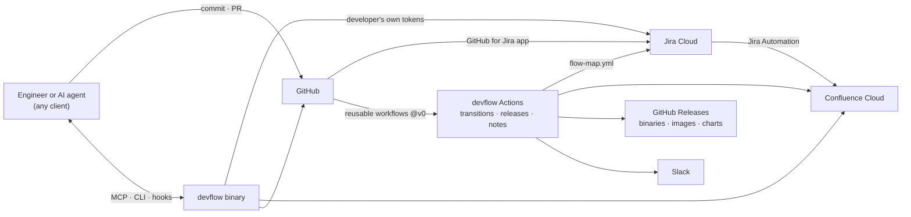

# devflow

[](https://github.com/nscaledev/devflow/actions/workflows/ci.yml)
[](https://github.com/nscaledev/devflow/actions/workflows/release.yml)

**devflow connects GitHub, Jira and Confluence into one delivery loop for Nscale
engineering.** Engineers state intent once, in the commit message, and devflow moves the
ticket, publishes the release, updates the docs and tells the team. The same rules apply
whether the work is done by a person in a terminal or by an AI agent in Claude Code,
Codex, Grok, Cursor, Copilot or Gemini.

| | |
| --- | --- |
| **Status** | Built and tested. Awaiting architecture approval (Kyle Redelinghuys, Vishal Srini) before rollout P0. No team uses it yet. |
| **Current release** | <!-- devflow:version -->`v0.3.0`<!-- /devflow:version --> · [CHANGELOG.md](CHANGELOG.md) · [all releases](https://github.com/nscaledev/devflow/releases) |
| **Owner** | Engineering Enablement · maintainer Ryan Helms |
| **Architecture** | [docs/blueprint.html](docs/blueprint.html): design, automations and rollout plan under review |
| **Support** | Open an issue in this repo · security issues: see [SECURITY.md](SECURITY.md) |

---

## Contents

- [Why devflow](#why-devflow)
- [What it does](#what-it-does)
- [Architecture](#architecture)
- [Getting started](#getting-started)
- [Day-to-day use](#day-to-day-use)
- [Commit convention](#commit-convention)
- [Versioning and releases](#versioning-and-releases)
- [AI client support](#ai-client-support)
- [Security and governance](#security-and-governance)
- [Operations](#operations)
- [How devflow itself is released](#how-devflow-itself-is-released)
- [Repository layout](#repository-layout)
- [Contributing](#contributing)
- [Documentation](#documentation)

## Why devflow

Without devflow, engineers move Jira tickets by hand, PRs link to tickets only when
someone remembers, releases are cut inconsistently, and Confluence drifts away from the
code. devflow makes git the source of truth and turns the rest into automation:

- **Tickets move themselves.** Branch, PR, merge and deploy events move each ticket
  through *its own team's* Jira workflow, using one reviewed status map.
- **Every deployable is versioned and released the same way.** Semantic versions come from
  commit types, every release is a GitHub Release with attested artifacts, and production
  only deploys releases.
- **Docs and notes write themselves.** Release notes, design-doc pages and sprint reports
  are generated into Confluence.
- **AI agents follow the rules.** The devflow plugin gives agents the ticket context, writes
  convention commits, previews Jira effects and asks before acting.

## What it does

| Area | Capabilities |
| --- | --- |
| **Commit and PR hygiene** | Commit convention with Jira keys, enforced locally (`commit-msg`) and in CI (PR key check) · generated, validated and split commits · PR readiness checks and PR creation from templates |
| **Ticket flow** | Branch → In Progress, PR → In Review, merge → QA/Done, deploy → Released, mapped per project in [`flow-map.yml`](flow-map.yml) · commit verbs `#start #review #qa #done #block` · forward-only transitions |
| **Versioning and releases** | SemVer for apps, services, CLIs, images, Helm charts and libraries · one version per deployable unit · fully automatic GitHub Releases · branch-aware prerelease versions · production release guard with an approved hotfix path · Jira fix versions |
| **Confluence** | Release notes, docs-as-code sync, epic design pages, sprint reports from shared templates |
| **Signals** | Slack notifications, hygiene checks (stale PRs, idle tickets), incident flow, Jira issues from security alerts and failing builds |
| **AI assist** | 26 MCP tools, ticket context at session start, acceptance-criteria tracking, scope-drift checks, standups, Claude PR drafts (opt-in) |

## Architecture



devflow has two halves that share one status map and one set of rules:

1. **Reusable GitHub Actions** (`.github/workflows/`, `actions/`) react to code events in
   every opted-in repo: Jira key checks, ticket transitions, semantic releases, release
   guard, Confluence publishing, Slack and hygiene. Repos call them at `@v0` from a single
   caller workflow.
2. **The `devflow` binary**, one Go program that is a CLI, an MCP server and a set of git
   and AI-client hooks. Each repo commits a small launcher that installs the latest
   verified release on first use; the binary then keeps itself updated.

Responsibilities are split deliberately: the GitHub for Jira app links development data,
devflow Actions handle everything that starts in code, and Jira Automation handles
everything that starts in Jira. See [the blueprint](docs/blueprint.html#architecture).

## Getting started

### Enable devflow in a repository (repo owners)

Prerequisites: the org-level secrets and variables in
[docs/operations.md](docs/operations.md), and your project's block in
[`flow-map.yml`](flow-map.yml).

```bash
gh release download --repo nscaledev/devflow --pattern "devflow_*_$(uname -s | tr A-Z a-z)_$(uname -m | sed 's/x86_64/amd64/;s/aarch64/arm64/').tar.gz" -O - | tar -xz devflow
./devflow init && rm ./devflow
git add -A && git commit -m "chore(PLAT-123): enable devflow"
```

`devflow init` writes the files in [`templates/repo/`](templates/repo/) and sets up
releases:

| File | Purpose |
| --- | --- |
| `.devflow/config.yml` | Jira site and projects, commit rules, autonomy ceiling, update channel |
| `.devflow/releases.yml` + release-please files | Deployable units and branching strategy for semantic releases |
| `.devflow/bin/devflow` (+ `.cmd`, `.ps1`) | Launcher: installs and verifies the binary, then runs it |
| `.githooks/commit-msg` | Local commit convention check |
| `.github/workflows/devflow.yml` | The one caller workflow for every devflow Action |
| `.jira/config.yml` | Maps GitHub Environments to Jira deployment environments |
| `.claude/`, `.codex/`, `.grok/`, `.cursor/`, `.vscode/`, `.gemini/`, `AGENTS.md` | AI client configuration |

Disable devflow in a repo at any time with the repository variable `DEVFLOW_ENABLED=false`.

### Set up your machine (engineers)

Nothing to install by hand: opening the repo in any supported client runs the launcher.

```bash
devflow login     # your own Atlassian API token, stored in the OS keychain; reuses gh auth
devflow doctor --fix   # checks binary, hooks, auth, flow map and client config
```

## Day-to-day use

| Task | Terminal | AI client |
| --- | --- | --- |
| Pick up a ticket | `devflow start` | `/devflow:start` or "start PLAT-123" |
| See the ticket context | `devflow context` | loaded automatically at session start |
| Commit | `devflow commit` (or plain `git commit`) | `/devflow:commit` |
| Preview Jira effects | `devflow preview` | shown before every commit |
| Open a PR | `devflow pr` | `/devflow:pr` |
| Address review comments | `devflow review` | `/devflow:review` |
| Check CI, deploys, ticket | `devflow status` | `/devflow:status` |
| Standup | `devflow standup` | `/devflow:standup` |
| Next release version | `devflow release plan` | "what version will this ship as?" |

Each developer chooses an autonomy level per action class (`suggest`, `confirm` or
`auto`) in `~/.devflow/config.yml`, capped by the repo's `policy.max_autonomy`. The
default is `confirm`: the agent shows what it will do and waits.

## Commit convention

```
<type>(<JIRA-KEY>[,<KEY>])[!]: <imperative summary> [#verb]

[body: why the change was needed]

[BREAKING CHANGE: what breaks and how to migrate]
[Refs: PLAT-456]
[Devflow: skip]
```

- `type`: `feat fix perf refactor docs test build ci chore revert`
- `#start #review #qa #done #block` move the ticket through `flow-map.yml`; Jira Smart
  Commits still handle `#comment` and `#time`
- `feat` → minor, `fix`/`perf` → patch, `!` or `BREAKING CHANGE:` → major
- No AI attribution trailers; devflow strips known ones

## Versioning and releases

Every deployable asset is versioned with SemVer and shipped as a GitHub Release, which is
the system of record for what runs in production.

- **Automatic.** Each merge to the default branch with `feat`, `fix` or `!` commits
  publishes a release for every changed unit, with changelog, artifacts and attestations.
- **Per deployable.** Units live in `.devflow/releases.yml`; monorepo tags carry the unit
  (`api-v1.4.0`).
- **Branch-aware.** Other branches build prereleases: `-alpha` (GitFlow `develop`),
  `-rc` (`release/*`), `-hotfix` (`hotfix/*`), `-pr` (everything else).
- **Production takes releases.** `actions/release-guard` blocks anything but a published
  release, except an approved hotfix through the `production-hotfix` environment, which
  must end in a patch release.
- **Artifacts.** Binaries (GoReleaser), container images (`X.Y.Z`, `X.Y`, `X`, sha),
  Helm charts (OCI) and libraries (Go submodule tags, npm, PyPI, Terraform).

Full rules and examples: [docs/releases.md](docs/releases.md).

## AI client support

| Layer | Claude Code | Codex CLI | Grok CLI | Cursor · Copilot · Gemini | Terminal |
| --- | --- | --- | --- | --- | --- |
| Tools | Plugin MCP | MCP | MCP | MCP | CLI |
| Instructions | Plugin skill | `AGENTS.md` | Instructions file | `AGENTS.md` / rules | – |
| Commands | `/devflow:*` | Custom prompts | Where supported | Where supported | Subcommands |
| Hooks | SessionStart, PreToolUse, Stop | git hooks | git hooks | git hooks | git hooks |

Enforcement is identical everywhere: the `commit-msg` hook locally and the PR key check in
CI. Install the Claude Code plugin for yourself with
`/plugin install devflow --marketplace nscaledev/devflow`; repos enable it for everyone
through `.claude/settings.json`.

## Security and governance

- **Identity.** Writes use each developer's own Atlassian and GitHub credentials from the
  OS keychain, so history shows the real person. CI uses a scoped service account.
- **Release integrity.** devflow installs only builds whose SHA-256 and GitHub build
  attestation (`gh attestation verify --repo nscaledev/devflow`) both verify.
- **Untrusted content.** Ticket, page and review text reaches agents as labelled reference
  data; remote writes derived from it always need confirmation.
- **Never list.** At every autonomy level devflow refuses force-pushes, pushes to protected
  branches, PR merges, remote branch deletes and acting as another user.
- **Audit.** Every local and remote action is logged to `~/.devflow/audit.log`.
- **Change control.** `flow-map.yml` blocks need the owning team lead's approval
  ([CODEOWNERS](CODEOWNERS)); reusable workflows are versioned at `@v0`.

Report vulnerabilities as described in [SECURITY.md](SECURITY.md).

## Operations

| Task | How |
| --- | --- |
| Org secrets, GitHub App, Atlassian service account | [docs/operations.md](docs/operations.md) |
| Rollout phases and checklists | [docs/rollout.md](docs/rollout.md) |
| Stop a bad devflow release everywhere | Add it to `blocked` in [`policy/versions.json`](policy/versions.json); installs update or stop on their next start |
| Pause devflow in one repo | Repository variable `DEVFLOW_ENABLED=false` |
| Roll back the binary on a machine | `devflow update --rollback` |

## How devflow itself is released

This section is about the devflow repository's own releases, not the release tooling
devflow offers other repos.

- **Single branch.** Every push to `main` derives the next version from the commit types
  since the last `vX.Y.Z` tag (`bin/next-version.sh`). The release workflow generates the
  [CHANGELOG.md](CHANGELOG.md) section from those commits, commits it as
  `chore(release): vX.Y.Z`, tags it and publishes the GitHub Release with the same notes.
  No Release PR.
- **Same commit convention as devflow-managed repos.** Enforced locally by
  `.githooks/commit-msg` and in CI on every PR title and commit. `CHANGELOG.md` is never
  edited by hand.
- **Stable immediately.** Every release is a normal GitHub Release marked "Latest", and the
  floating major tag (`v0` while devflow is 0.x) moves to it. Safety comes from
  `policy/versions.json` (block a version everywhere) and `devflow update --rollback`.
- **Updates.** Installs check at most every 6 hours without blocking, verify each build,
  swap it in atomically, and keep the previous version for rollback.
- **Merging.** PRs are squash-merged, so the PR title decides the version bump.

## Repository layout

```
cmd/devflow/              CLI entry point
internal/                 operations (app), MCP server, hooks, commit engine, flow map,
                          release maths, policy, self-update, Atlassian and GitHub clients
adapters/                 per-client files; adapters/claude-code is the Claude Code plugin
templates/repo/           files devflow init writes into a consuming repo
.github/workflows/        devflow's CI and releases, plus reusable workflows for other repos
actions/                  composite actions: setup, ship, version, release-guard
bin/                      shell helpers used by workflows and actions
flow-map.yml              canonical events → each project's Jira statuses
policy/versions.json      minimum and blocked devflow versions
jira-automation/          Jira Automation rule specs
confluence-templates/     design doc, postmortem, release notes, sprint report
docs/                     blueprint, releases, rollout, operations
scripts/                  e2e test, blueprint build, agent-docs check
```

## Contributing

```bash
make check     # vet, race tests, golangci-lint, shellcheck, actionlint, agent docs
make e2e       # end-to-end Claude Code plugin test
```

Read [CONTRIBUTING.md](CONTRIBUTING.md) first. AI agents working on this repo follow
[AGENTS.md](AGENTS.md); `CLAUDE.md` only points to it and must not be edited.

## Documentation

| Document | For |
| --- | --- |
| [docs/blueprint.html](docs/blueprint.html) | Architecture, automations, plugin, rollout and decisions |
| [docs/releases.md](docs/releases.md) | Semantic versioning, GitHub Releases, release guard |
| [docs/rollout.md](docs/rollout.md) | Phase-by-phase rollout checklist |
| [docs/operations.md](docs/operations.md) | Secrets, apps, accounts, token rotation, blocking releases |
| [CHANGELOG.md](CHANGELOG.md) | Generated release history of devflow |
| [CONTRIBUTING.md](CONTRIBUTING.md) | Building, testing and changing devflow |
| [AGENTS.md](AGENTS.md) | Instructions for AI agents working on this repo |
| [SECURITY.md](SECURITY.md) | Security model and reporting |

---

Internal to Nscale. Not licensed for external use or distribution.
